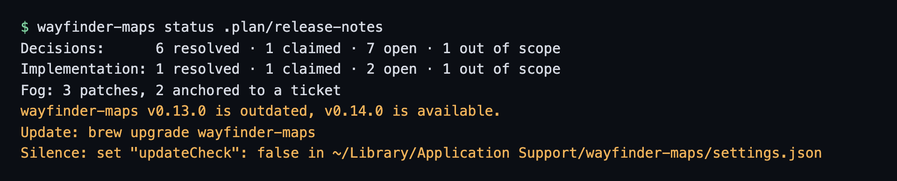

# wayfinder-maps

A CLI and star-map viewer for [wayfinder](https://github.com/mattpocock/skills/tree/main/skills/engineering/wayfinder) maps: the markdown planning memory an agent leaves under `.plan/<effort>/` while it charts a large effort as a graph of investigation tickets, resolved one per session.

- The wayfinder method and its skills were created by [Matt Pocock](https://github.com/mattpocock) in [mattpocock/skills](https://github.com/mattpocock/skills). This repo ships adapted copies, so one install gets you the method and the tools.
- The CLI and viewer were created by John Goh in [rengwu/wayfinder-maps](https://github.com/rengwu/wayfinder-maps). This fork extends both so a map carries on into implementation, see [fork vs upstream](docs/features/index.md).

Full docs live at [ramseskools.github.io/wayfinder-maps](https://ramseskools.github.io/wayfinder-maps/).

## Install

The skills, as a Claude Code plugin:

```
/plugin marketplace add RamsesKools/wayfinder-maps
/plugin install wayfinder-maps@wayfinder-maps
```

The binary on macOS or Linux, then the matching skills for Claude Code, GitHub Copilot or Codex:

```sh
curl -fsSL https://raw.githubusercontent.com/RamsesKools/wayfinder-maps/main/scripts/install.sh | bash
wayfinder-maps install-skill
```

Windows, pinned releases, drop-in skills, updates and building from source are on the [install page](docs/install.md).

When a newer release exists, commands end with a short notice on stderr with the update command for your install (terminal only, never in CI):



Silence it by setting `"updateCheck": false` in `settings.json`, or turn off Update check in the viewer's settings, see [Outdated notice](docs/features/update-notice.md).

## Usage

1. Ask your agent to run `/wayfinder-maps` on a big, foggy effort. It charts the map under `.plan/<effort>/`.
2. Each later session claims a ticket from the frontier and resolves it.
3. Follow along from the terminal or the star-map:

```sh
wayfinder-maps status .plan/<effort>   # resolved, in flight, and ready to claim
wayfinder-maps lint .plan/<effort>     # does the map still tell the truth?
wayfinder-maps app .plan/<effort>      # the star-map in a native window (serve for a browser)
```

The [guide](docs/guide/usage.md) covers every command, the map format and maps kept as GitHub issues.

## Contributing

- Vote on [issues](https://github.com/RamsesKools/wayfinder-maps/issues) with a thumbs-up reaction, the most wanted go first.
- Raise ideas and ask questions in [Discussions](https://github.com/RamsesKools/wayfinder-maps/discussions), under Ideas or Q&A.

## Credits and license

MIT, see [LICENSE](https://github.com/RamsesKools/wayfinder-maps/blob/main/LICENSE).
The CLI and viewer are by John Goh, the wayfinder method and skills by Matt Pocock (MIT, see [skills/LICENSE](https://github.com/RamsesKools/wayfinder-maps/blob/main/skills/LICENSE)).
This is a fork of [rengwu/wayfinder-maps](https://github.com/rengwu/wayfinder-maps) and is not merged back upstream.

- [Docs](https://ramseskools.github.io/wayfinder-maps/)
- [Releases](https://github.com/RamsesKools/wayfinder-maps/releases)
- [Discussions](https://github.com/RamsesKools/wayfinder-maps/discussions)
