# Rengwu's wayfinder CLI vs RamsesKools' wayfinder CLI

[rengwu/wayfinder-maps](https://github.com/rengwu/wayfinder-maps) stops where the
decisions stop: a map is done when the way is clear, and the build happens somewhere else.
This fork lets a map carry on into the implementation, so the whole journey lives in one
graph. A map with no implement tickets reads exactly as it does upstream.

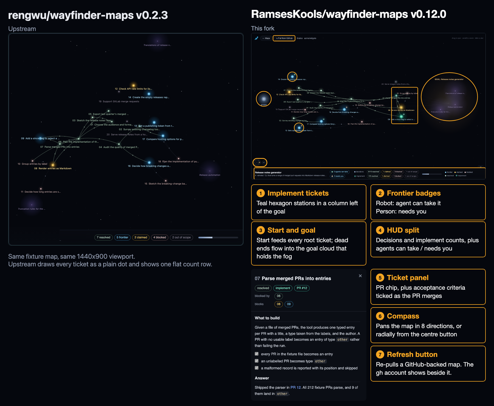

## What this fork adds

- **`implement` tickets.** Each one ships in one repo, usually as one PR, with a `## What to build`
  body plus acceptance criteria, and resolves when the work has shipped. The optional `pr:`
  field links the PR when there is one.
- **Planning the implementation.** A "Plan the implementation of X" grilling ticket breaks
  the destination into implement tickets, following
  [`IMPLEMENT-PLAN.md`](../skills/wayfinder-maps/IMPLEMENT-PLAN.md).
- **`## Implemented so far`.** It lists shipped work, next to Decisions-so-far.
- **AFK or HITL per ticket.** Every frontier ticket says whether an agent can take it
  alone or it needs you, so a hub session can run the AFK ones in parallel workers.
  A task marks itself with `afk: true`.
- **`status` splits the map.** With implement tickets it counts decisions and
  implementation separately, lists in-flight and shipped implement tickets (with their PR, when they have one),
  and marks every frontier row AFK or HITL.
- **Lint and graph JSON** know about all of the above.
- **`pull`** imports the `wayfinder:implement` and `wayfinder:afk` labels and
  the linked PRs.
- **Viewer.** Implement tickets are hexagonal stations in an outer belt, frontier tickets
  carry an agent or person badge, and a ticket panel links its PR when it has one.
- **Flow direction.** A small compass in the bottom left corner points the map any of 8 ways, and
  the centre button drops the direction for the original radial layout. East (left to
  right) is the default.
  The choice is saved in `settings.json` next to `recents.json` in your user config
  directory, so it survives restarts.

  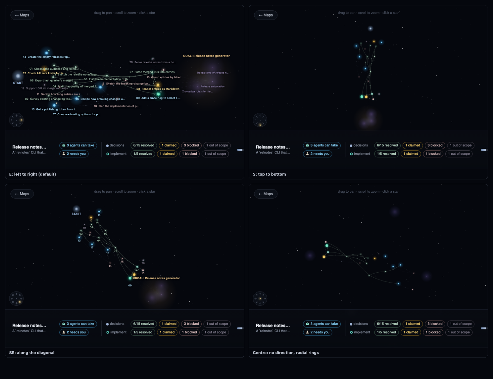

  South (top to bottom) suits a tall, narrow column: it fills the width and opens on the
  start.

  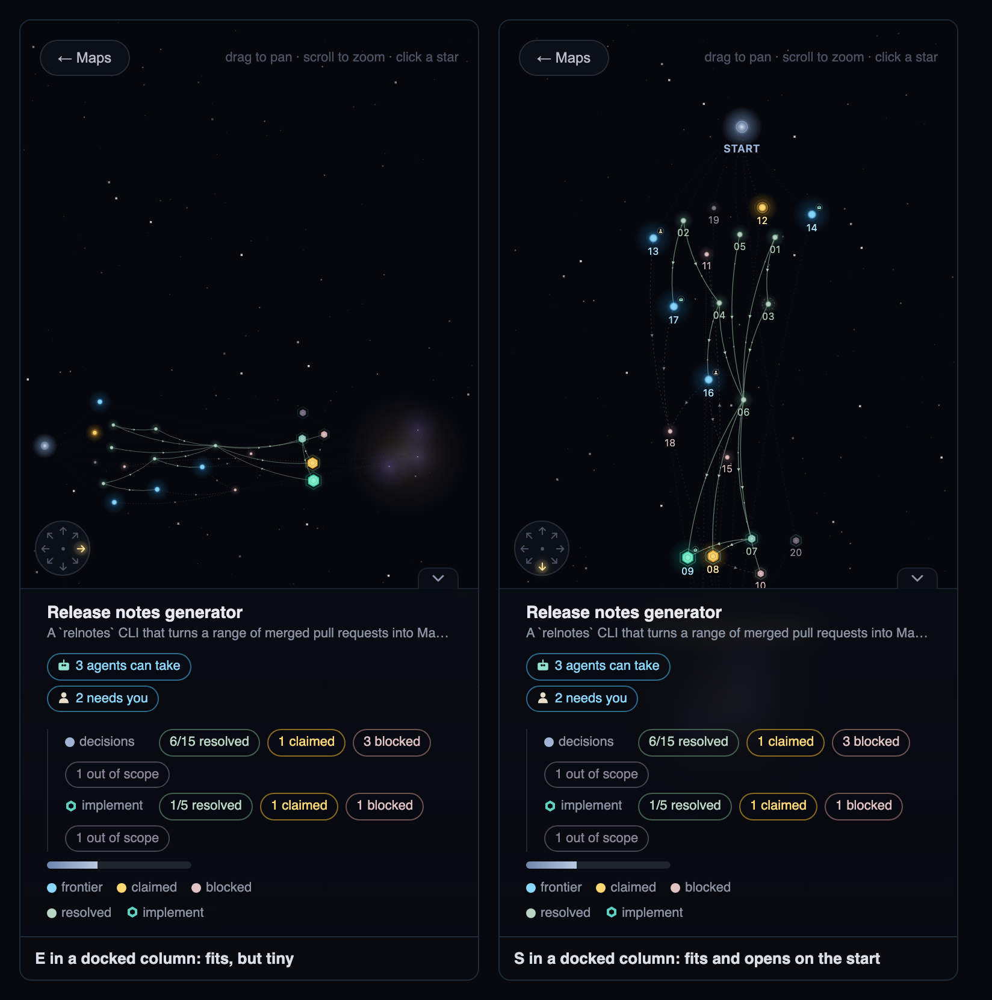

- **Narrow screens.** The bottom status bar wraps onto extra rows instead of running off the
  edge, so the title, counts, progress bar and legend all stay visible.

  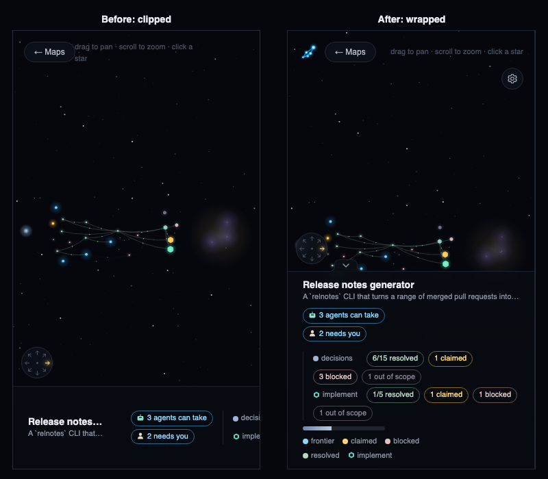

  The small arrow tab on the bar's top edge folds it down to just the title, and back out.

  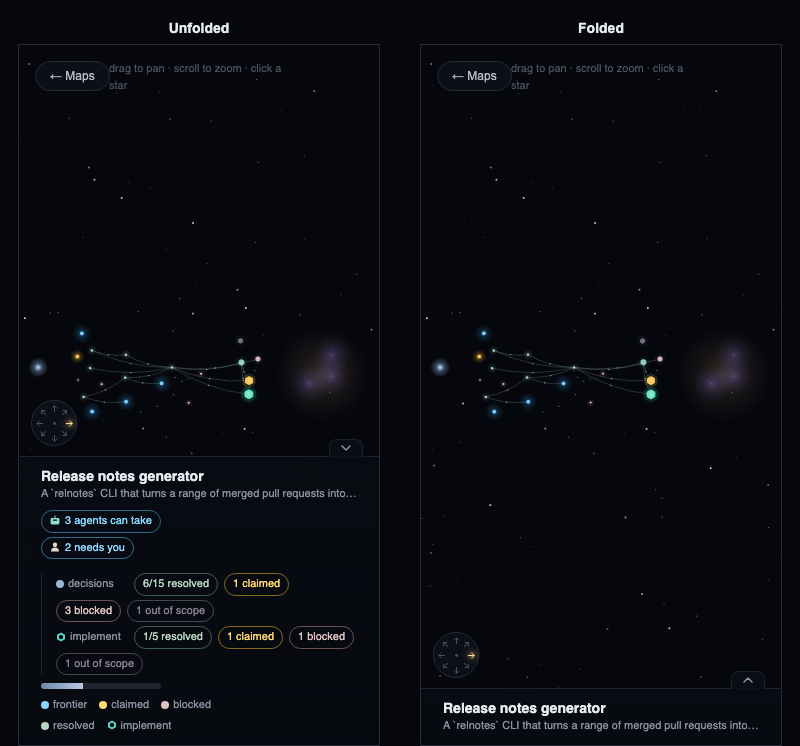

- **One top bar.** The Maps and Pull buttons, the project name and the hint share a single bar that wraps onto extra rows instead of overlapping, and it gives way to the detail panel when that opens.

  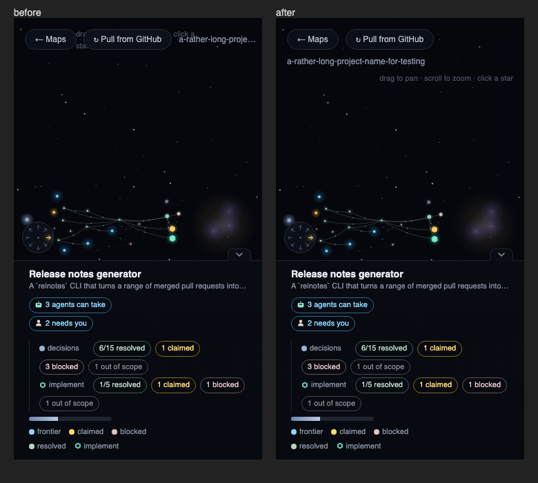

  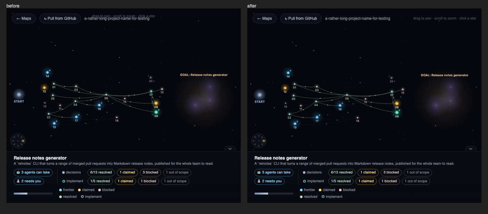

The [design record](implement-phase-design.md) has the full plan.

## Added since the first comparison

- **`wayfinder-maps pull` in the binary.** Upstream ships a `wayfinder-pull` script that mirrors a map kept as GitHub issues into `.plan/`.
  Here it is a subcommand, with the implement labels and linked PRs imported, see [Maps kept as GitHub issues](../README.md#maps-kept-as-github-issues).
- **Pull from the viewer.** A Pull button in the top bar re-pulls the map and streams progress (spinner and `N/M items`), then a done or error state.
- **Choosing the `gh` account.** `--account <gh-user>` pulls as another logged-in account, and the viewer shows which account it uses, see [Choosing the gh account](../README.md#choosing-the-gh-account).

  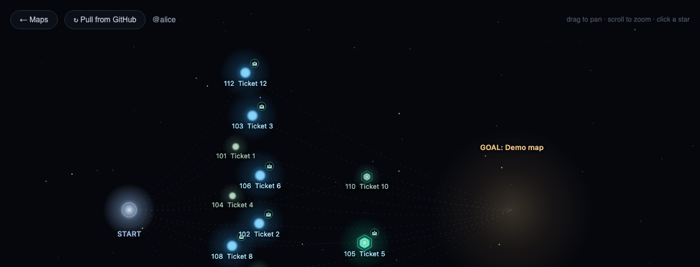

  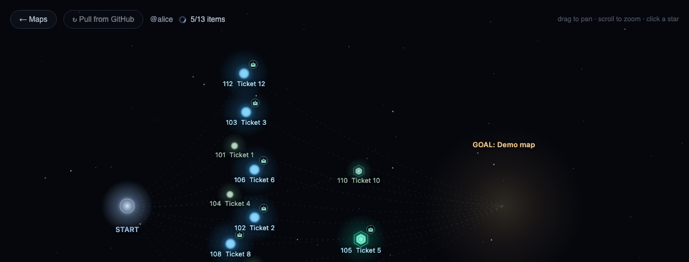

- **Pull progress on the CLI.** A progress bar on a terminal, plain `pulled N/M items` lines in CI, see [Progress](../README.md#progress).

  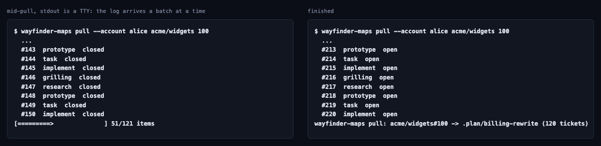

- **`wayfinder-maps self-update`.** The binary upgrades itself in place, with a sha256 check, `--check` and version pinning, see [Updating the binary](../README.md#updating-the-binary).

  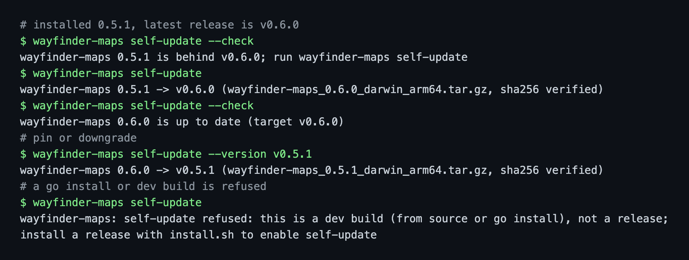

- **`wayfinder-maps install-skill`.** The skills are embedded in the binary and installed per harness with a lock file, so they always match `status` and `lint`, see [Installing the skills](../README.md#installing-the-skills).

  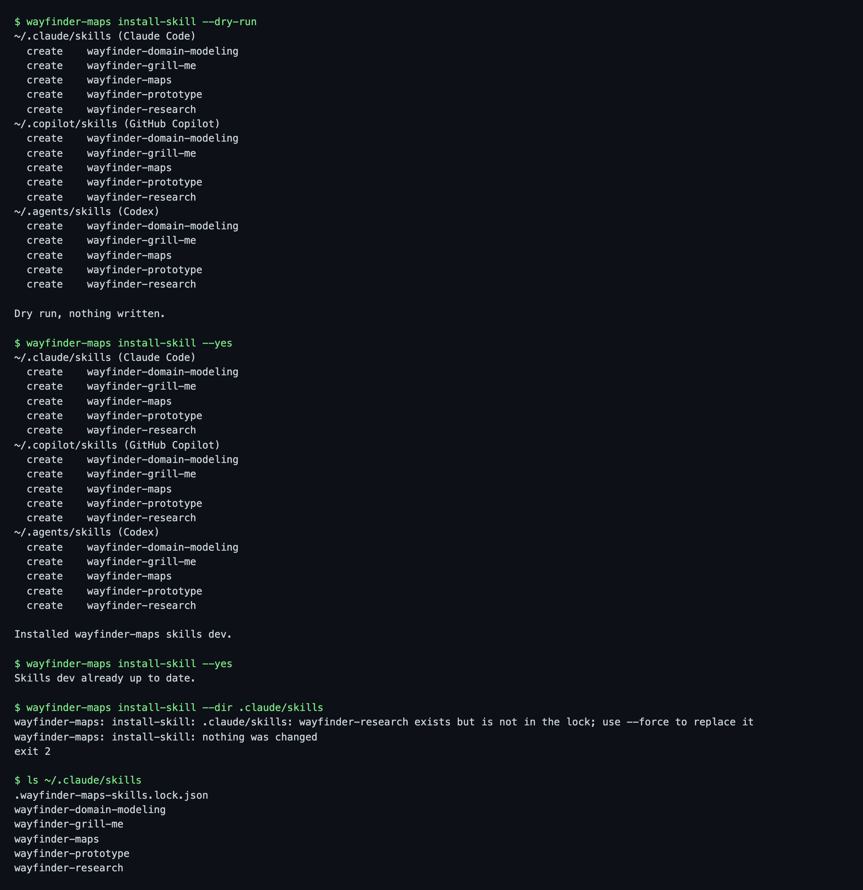

- **`--version`.** On `wayfinder-maps` and the Linux webview helper.
- **Favicon.** The viewer tab shows a small glowing constellation climbing from a lone start light to a finish light.
  Blue is the default, red and green ship as spare variants for a future status signal.

  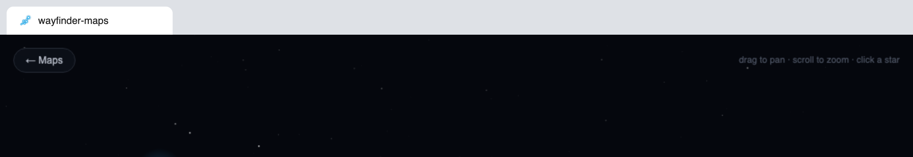

  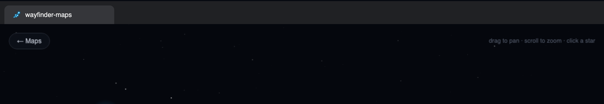

  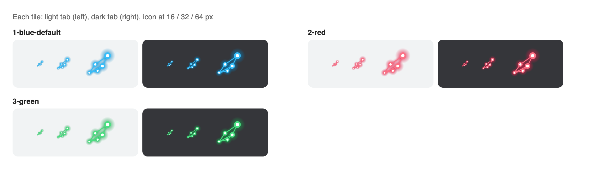

## Why these additions

Wayfinder exists because planning and deciding don't always fit in one session. I think
the same holds for implementation:

1. Some of the fog only clears once you start building. An implementation regularly turns
   up new questions that need a grilling, research or a prototype, and those belong on
   the same map rather than in a fresh plan.
2. I like tracking progress on the visual map, and an implementation too big for one
   session deserves that view as well.

So one map now tracks the decisions and the implementation, all the way until the work is
done.
