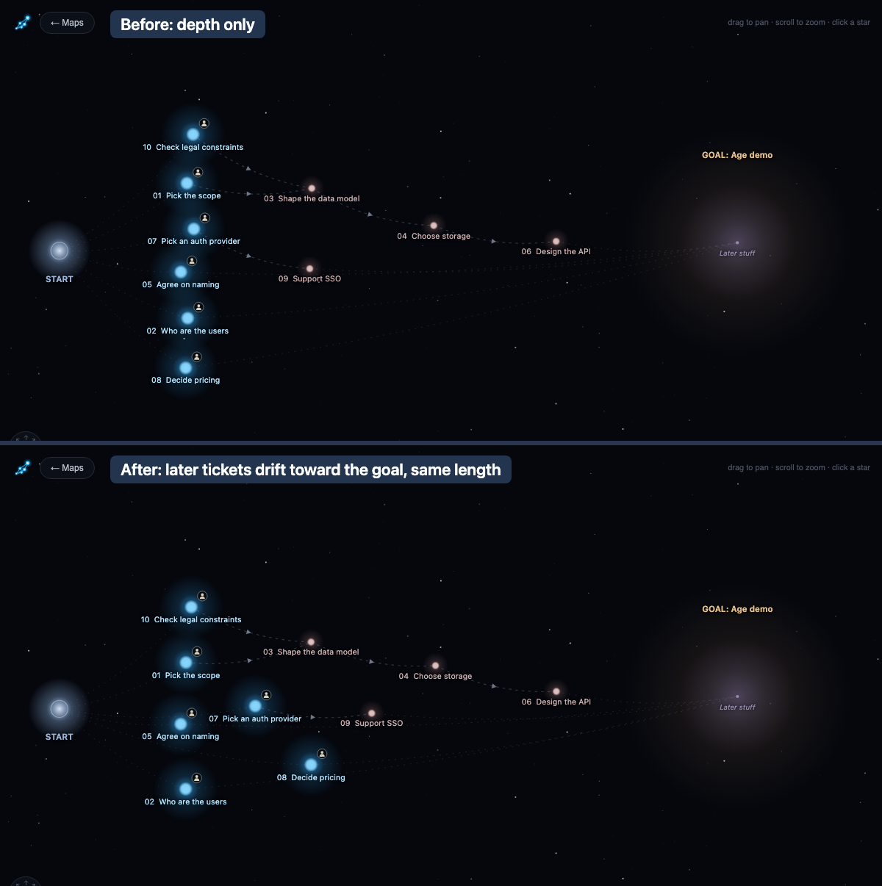

# Tickets placed by age

In a flow direction a ticket's column is its dependency depth, so every ticket without blockers used to sit next to the start.
Now creation order nudges tickets toward the goal, without making the map any longer:

- Tickets created within an hour of each other form one wave; only the order of waves counts, not the gaps.
- A ticket moves forward only within its slack, the room it has before something it unblocks would have to move.
  The longest chain of dependencies sets the length and stays put.
- Arrows still only point forward, and a new ticket that arrives while the map is open lands near the frontier.

The creation time comes from the issue for a map pulled from GitHub (saved as `created:` in the mirrored ticket), else the commit that first added the ticket file, else the file's creation time.
