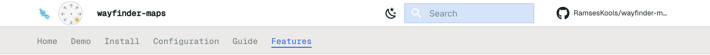
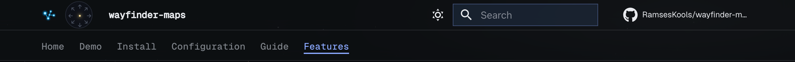
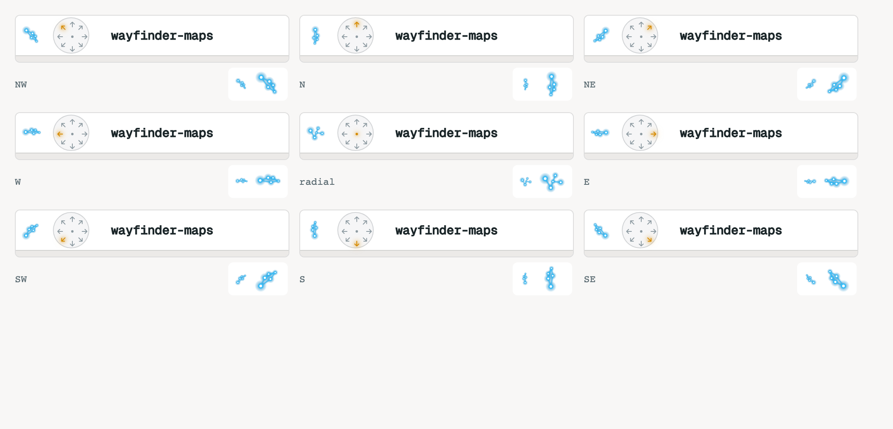
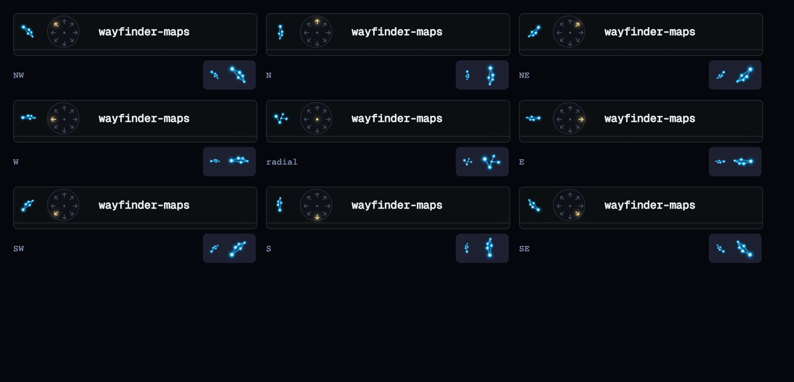

# Compass logo

A compass in the docs header, next to the logo, turns the logo like the [viewer's compass](compass.md) turns a map.
It is the viewer's own dial: eight arrows pick the flow, the centre button drops the direction.

## What it does

- East, south-east and the other six flows rotate the [logo](logo.md) so the constellation climbs that way, from the smallest star to the biggest.
  North-east is the logo as it ships.
- The centre button gives a radial logo: the start in the middle, the stars fanning out, and one pair joined to each other.
- The browser tab favicon follows the choice.
- The logo turns the short way round to its new direction, and fades to or from the radial one.
  Nothing animates when your system asks for reduced motion.
- The choice is kept in your browser, so the next page and the next visit start with the same logo.
  The light or dark scheme is remembered too, by the theme itself.
- Below the width where the theme hides the header logo, the dial hides too.
  The logo in the navigation drawer still follows the choice.

## All nine

Light header, each dial position with its logo and the favicon it gives at 16 and 32 px:

And the same in the dark header:

## How it works

The docs publish the viewer's `compass.js` and `direction.js` as they are, so the dial and its eight directions cannot drift from the viewer.
One small script draws the logo for a direction, by rotating the five stars and six lines of the NE logo about their centre, and writes it into the header logo and the favicon as an inline SVG.
The straight directions are a pure rotation, so they come out as long, flat constellations.
