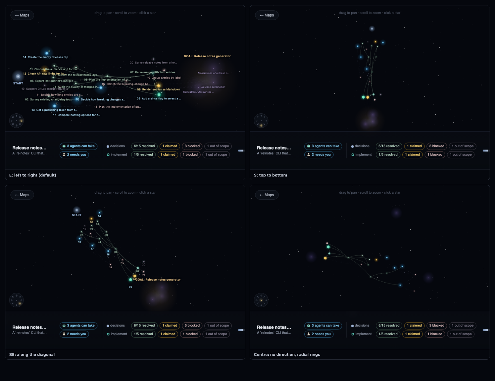
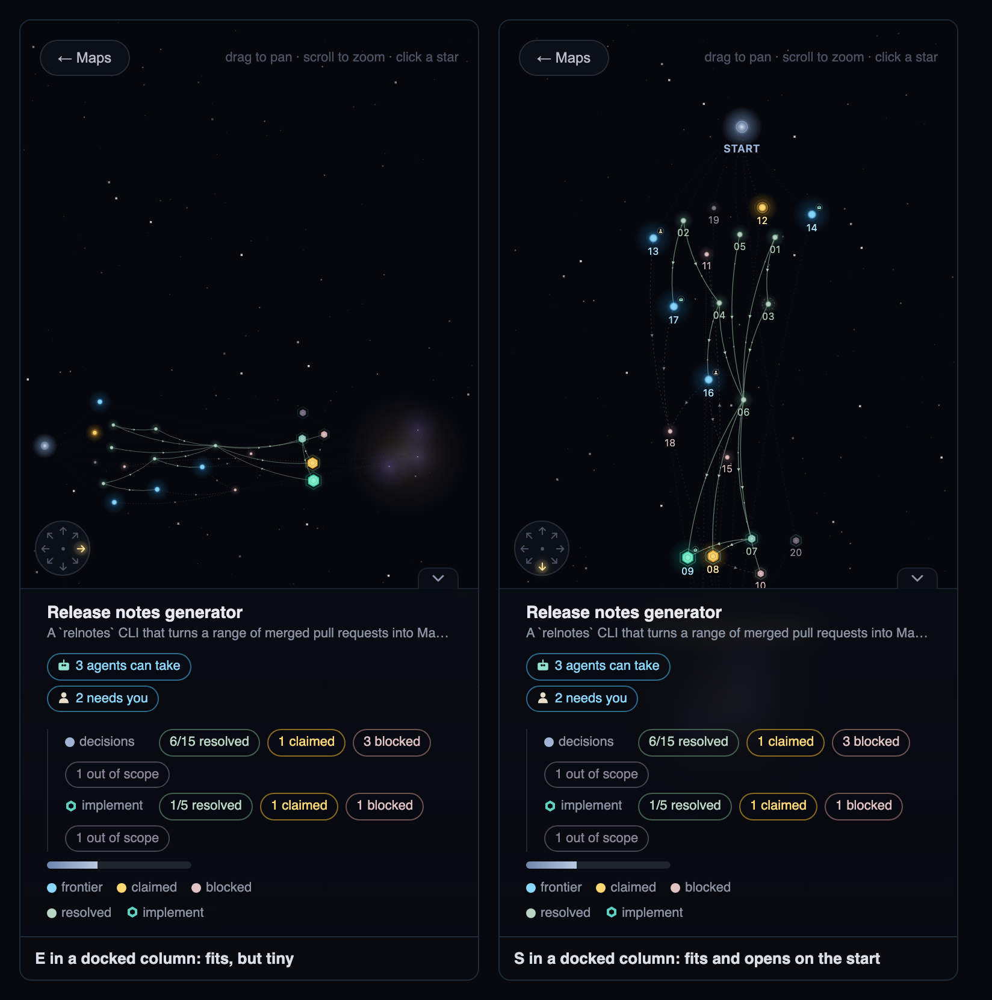

# Compass

A small compass in the bottom left corner points the map any of 8 ways, and the centre button drops the direction for the original radial layout.
East (left to right) is the default.
The arrow tab on the bar's top edge, right of the dial, folds and unfolds the [status bar](narrow-screens.md#collapsing-the-status-bar) and stays beside it either way.
The choice is saved in `settings.json` next to `recents.json` in your user config directory, so it survives restarts.

South (top to bottom) suits a tall, narrow column: it fills the width and opens on the start.

When the [status bar is collapsed](narrow-screens.md#collapsing-the-status-bar), the compass moves into the corner beside the map title.

The docs site header has the same dial, next to the logo: see [Compass logo](compass-logo.md).
