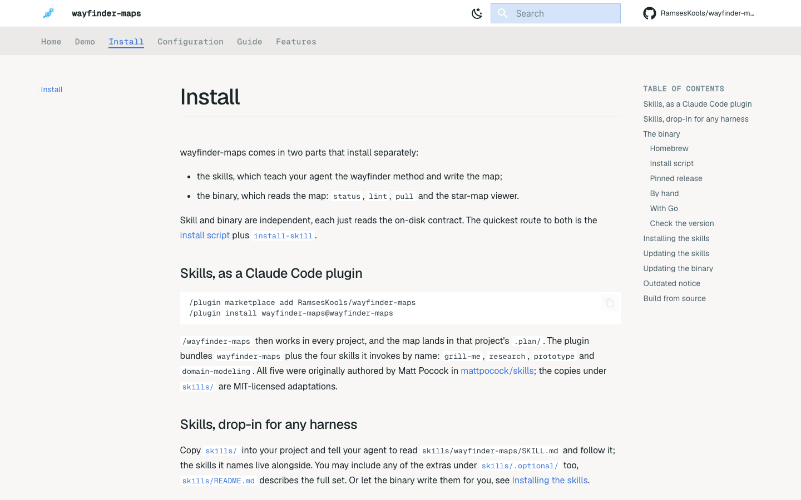
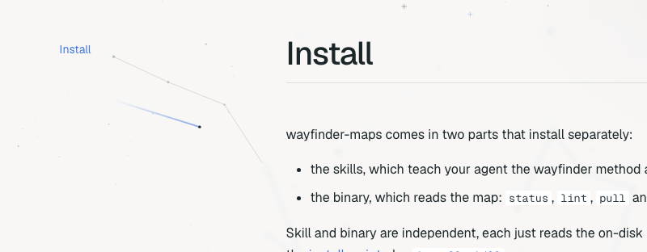
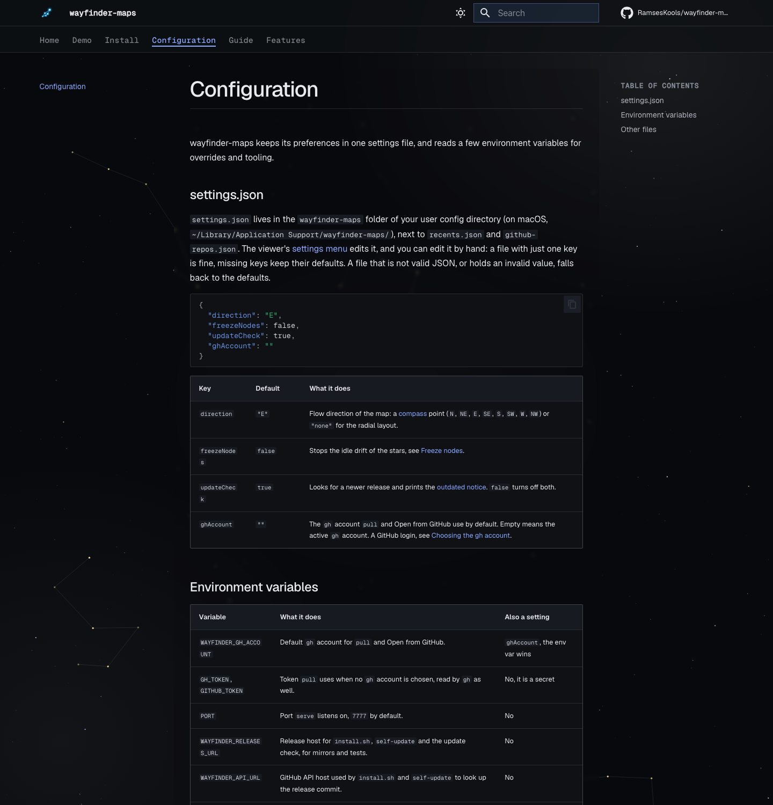

# Light and dark mode

The moon or sun button in the header switches the docs site between light and dark.
The choice is saved in the browser, and the first visit follows the system setting.

## The sky

Both schemes draw the same sky: three layers of stars that twinkle and drift very slightly, and a few small constellations.
Stars shift a little as you scroll, and the header, tabs and sidebar are translucent so the sky shows through.
The text column sits on a faint, blurred panel that mutes the sky behind it, so reading stays easy.
With `prefers-reduced-motion` the stars stay still and no shooting star appears.

- Dark mode is a night sky: white, pale blue and gold stars with a soft gray glow in the corners.
- Light mode is a printed star chart: faint ink dots in dark teal, ACD blue and slate on a stone-white page, the brightest stars as tiny `+` crosses, with a warm gray glow in the corners.

## Constellations

A handful of constellations are scattered across the sky: short chains of bright stars joined by faint lines.
They drift with the front layer of stars and show up the same way in both schemes, in light lines on dark and in ink on light.

## Shooting star

A star crosses the sky from one edge to another every minute or so, at random.
In dark mode it is a normal star with a short glowing trail, in light mode a fading blue ink stroke with a dark head.

To see one right away, triple-click the bottom right corner of the page, on bare sky (a small spot, not a button).
Nothing is drawn there, and the click does nothing on text, links, images, code or any other content.

## Page elements

Headings, body text, links, code, admonitions, tables, images, search and the footer all use a palette from the same tokens in both schemes: ACD blue, sage green and dark teal surfaces, with links turning gold on hover in dark mode.

