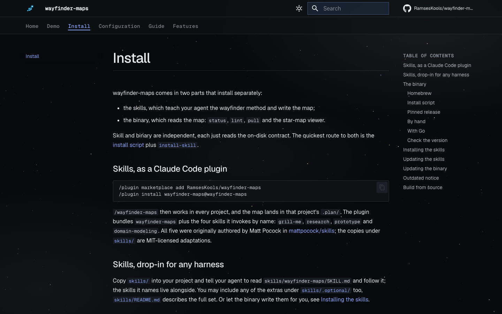
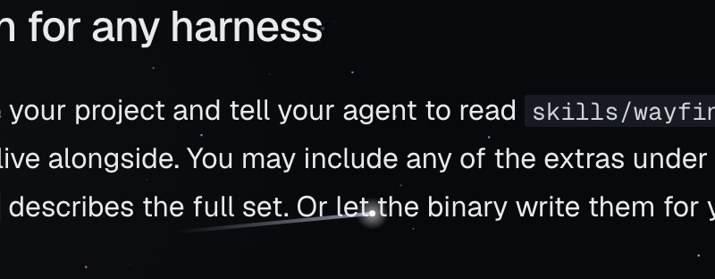
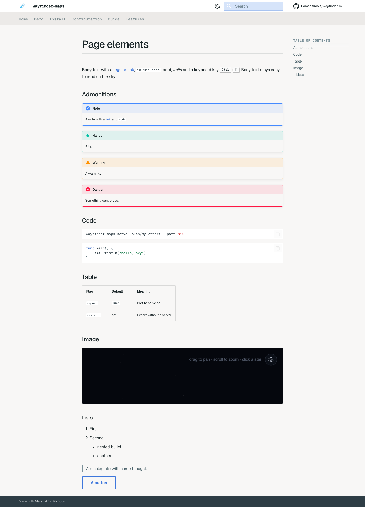

# Dark mode

The moon or sun button in the header switches the docs site between light and dark.
The choice is saved in the browser, and the first visit follows the system setting.

## The sky

The dark scheme sits on a night sky like the viewer's: three layers of stars that twinkle and drift very slightly, with a soft gray glow in the corners.
Stars shift a little as you scroll, and the header, tabs and sidebar are translucent so the sky shows through.
With `prefers-reduced-motion` the stars stay still and no shooting star appears.

## Shooting star

A star crosses the sky from one edge to another every minute or so, at random.
It looks like a normal star with a short glowing trail.

To see one right away, triple-click the bottom right corner of the page, on bare sky (a small spot, not a button).
Nothing is drawn there, and the click does nothing on text, links, images, code or any other content.

## Page elements

Headings, body text, links, code, admonitions, tables, images, search and the footer all use a dark palette from the same tokens as the light one: ACD blue (lighter), sage green and dark teal surfaces, with links turning gold on hover.

