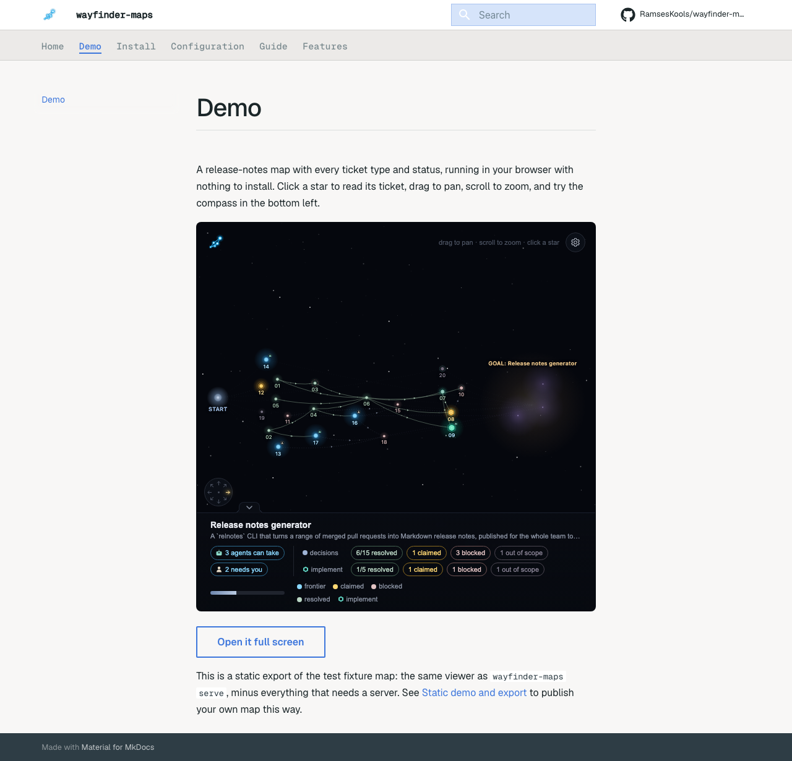

# Export to a static site

`wayfinder-maps export <map-dir> <out-dir>` writes a map as a plain website: the viewer plus a `graph.json` snapshot of the map.
Anyone can open it from any web server, with no `wayfinder-maps` binary and nothing to install.

```sh
wayfinder-maps export .plan/my-effort site
python3 -m http.server -d site
```

The [demo](../demo.md) on this site is an export of the test fixture map, rebuilt by every `mkdocs build` (see `docs_hooks.py`).



## Serving it

The page loads `graph.json` and ES modules, which browsers block on `file://`, so open it over http(s).
Any static host works: GitHub Pages, Netlify, S3, or `python3 -m http.server` for a quick local look.

## What changes in the exported viewer

The page carries a `<meta name="wayfinder-static">` flag.
When it is there, the viewer:

- Loads `graph.json` instead of asking a server, and never polls for changes.
- Hides what needs a server: Open Folder, recent maps, Open from GitHub, Refresh from GitHub and the back to Maps button.
- Keeps the [compass](compass.md) direction and Freeze nodes in the browser's `localStorage`, and hides the gh account and update check rows of the [settings menu](settings.md).

The `serve` and `app` viewer is unchanged.

## Notes

- The export is a snapshot: re-run it to pick up edits to the map.
- It includes every ticket's text, so only export maps you are happy to publish.
- `<out-dir>` is created if needed and files in it are overwritten.
  It cannot sit inside the map directory.
- The docs build needs Go on the PATH to export the demo. Without it a plain build only skips the demo with a warning, and `--strict` fails.
