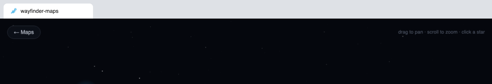
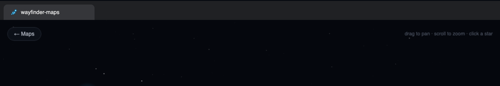
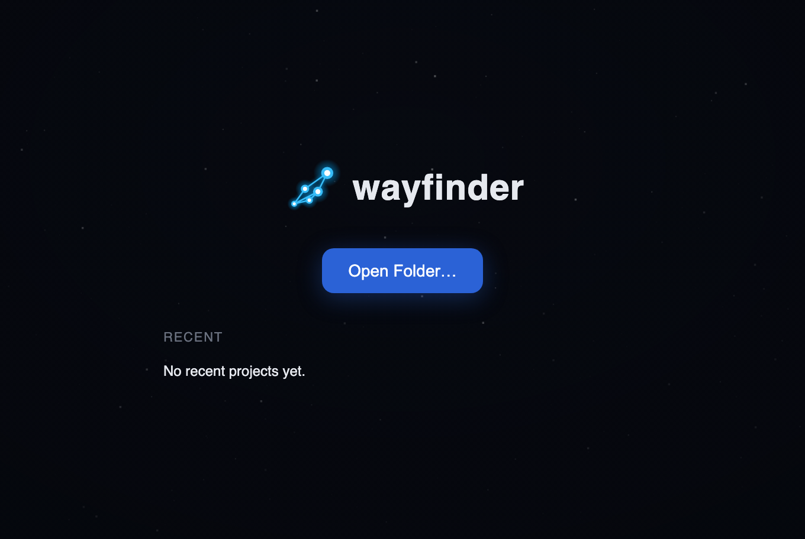
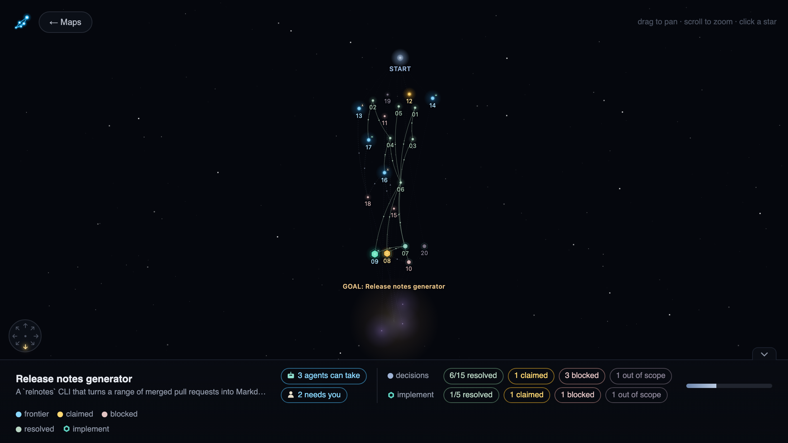
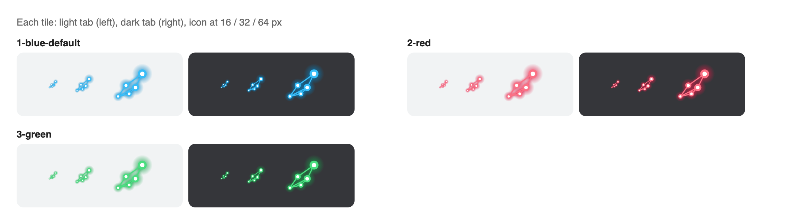

# Favicon

The viewer tab, the splash logo and the top left corner of the map show a small glowing constellation climbing from a lone start light to a finish light.
Blue is the default, red and green ship as spare variants for a future status signal.

