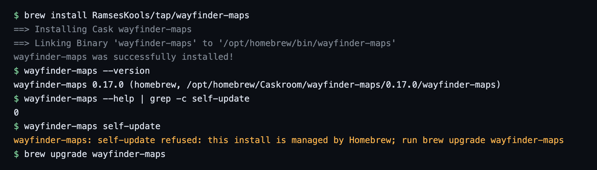

# Homebrew

On macOS the binary installs and upgrades through a Homebrew tap.

```sh
brew install RamsesKools/tap/wayfinder-maps
brew upgrade wayfinder-maps
```



## A Homebrew install knows it is one

- `wayfinder-maps --version` prints the install method and the binary path, `homebrew` for anything under the Caskroom or Cellar.
- `self-update` is hidden from `--help`, since Homebrew owns the files.
- Running `self-update` anyway refuses with exit 2 and `brew upgrade wayfinder-maps`, and changes nothing.
- The [outdated notice](update-notice.md) names the same `brew upgrade` command.
- Installs by `install.sh` still [self-update](self-update.md) as before.

## How the tap is fed

- Every `release` run commits the updated cask to [RamsesKools/homebrew-tap](https://github.com/RamsesKools/homebrew-tap), so a release is installable the moment it is published.
- A GitHub App token, minted for that one step and scoped to the tap with write access to contents only, pushes the commit.
  The commit shows up as the app and as Verified.
- The macOS binary is not signed yet, so the cask strips the quarantine flag after install, the same as `install.sh` does.
- macOS only, Windows and Linux use the [other routes](../install.md#the-binary).

[Install](../install.md#homebrew) has the details.
