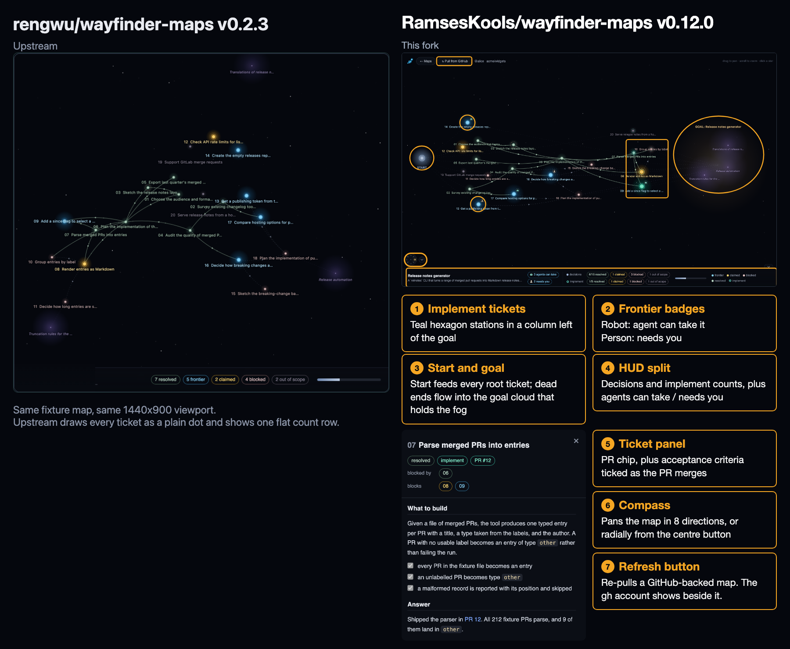

# Fork vs upstream

[rengwu/wayfinder-maps](https://github.com/rengwu/wayfinder-maps) stops where the decisions stop: a map is done when the way is clear, and the build happens somewhere else.
This fork lets a map carry on into implementation, so the whole journey lives in one graph.
A map with no implement tickets reads exactly as it does upstream.

## What this fork adds

| Addition | What it gives you |
| --- | --- |
| [`implement` tickets](implement-tickets.md) | Shipped work lives on the map, with an optional PR link |
| [AFK or HITL frontier](afk-hitl.md) | Each ready ticket says whether an agent can take it |
| [Split `status`, lint, graph JSON](implement-tickets.md#status-lint-and-graph-json) | Decisions and implementation counted apart |
| [Start and goal in the viewer](start-and-goal.md) | A virtual start and a goal cloud holding the fog |
| [Compass](compass.md) | The map flows in any of 8 directions or radially |
| [Tickets placed by age](age-layout.md) | Later tickets drift toward the goal without stretching the map |
| [Narrow-screen layout](narrow-screens.md) | Wrapping top bar and a status bar that collapses to a corner with the title and compass |
| [`pull` in the binary](pull.md) | GitHub-issue maps mirrored into `.plan/`, with account choice and progress |
| [Refresh button](pull.md#refresh-from-the-viewer) | The same pull from the viewer |
| [Open from GitHub](open-from-github.md) | Find a map in a repo and open it from the splash, with account choice, no `pull` first |
| [Recent maps](recent-maps.md) | Maps opened from the CLI or the viewer are listed on the splash |
| [`install-skill`](install-skill.md) | Skills embedded in the binary, installed per harness |
| [`self-update`](self-update.md) | The binary upgrades itself |
| [`--version`](../install.md#check-the-version) | On `wayfinder-maps` and the Linux webview helper |
| [Favicon](favicon.md) | A glowing constellation in the browser tab |

The [design record](https://github.com/RamsesKools/wayfinder-maps/blob/main/docs/implement-phase-design.md) has the full plan for the implement phase.

## Why these additions

Wayfinder exists because planning and deciding don't always fit in one session.
I think the same holds for implementation:

1. Some of the fog only clears once you start building.
   An implementation regularly turns up new questions that need a grilling, research or a prototype, and those belong on the same map rather than in a fresh plan.
2. I like tracking progress on the visual map, and an implementation too big for one session deserves that view as well.

So one map now tracks the decisions and the implementation, all the way until the work is done.
