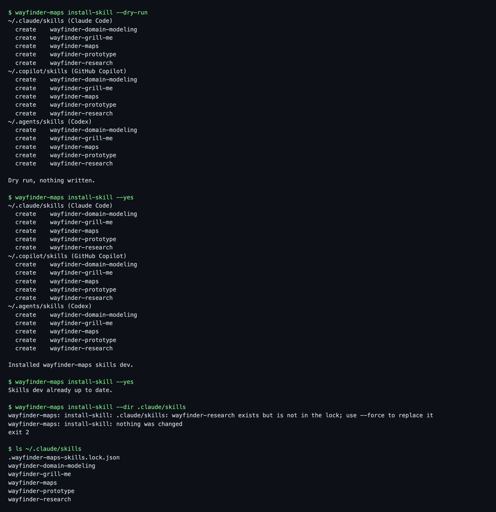
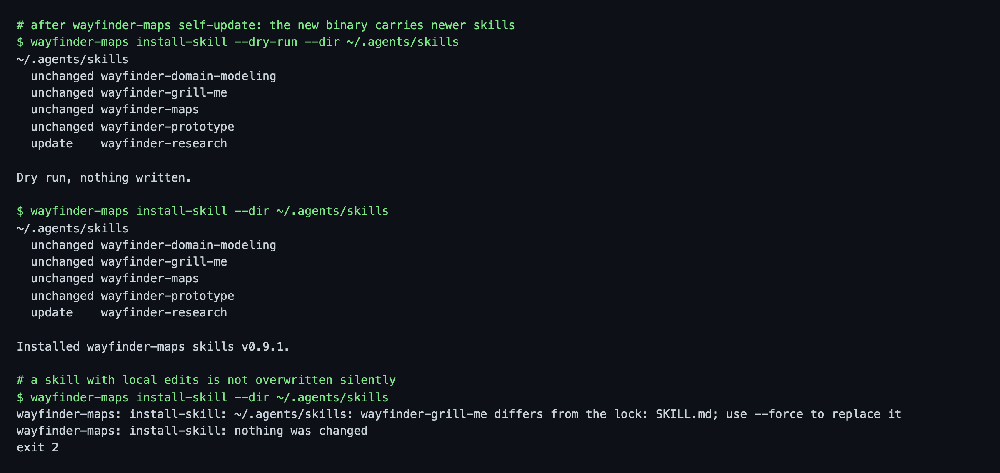

# install-skill

The skills are embedded in the binary and installed per harness with a lock file, so they always match what `status` and `lint` do.

```sh
wayfinder-maps install-skill
```

- It proposes the personal skills dirs of Claude Code, GitHub Copilot and Codex and asks per dir; `--yes` or `--dir` skip the questions.
- Skills install as `wayfinder-<name>`, so they never clash with your own `grill-me`.
- A lock file per dir tracks what it manages, and a locally edited skill blocks the run unless you pass `--force`.



Updating is `self-update` followed by `install-skill`:



[Install](../install.md#installing-the-skills) has every flag and rule.
