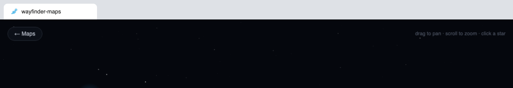
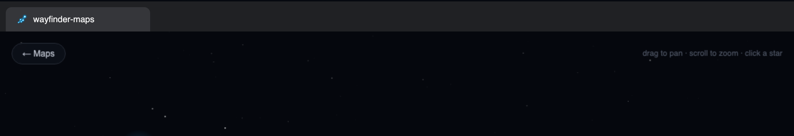
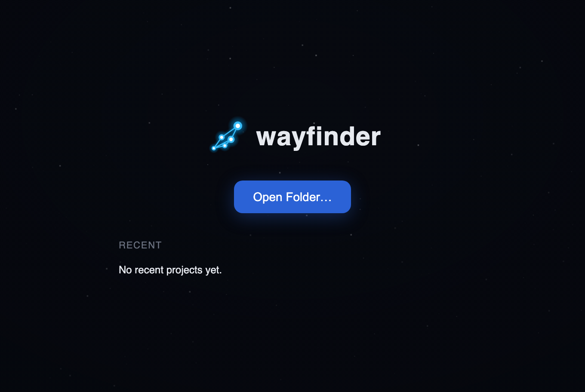
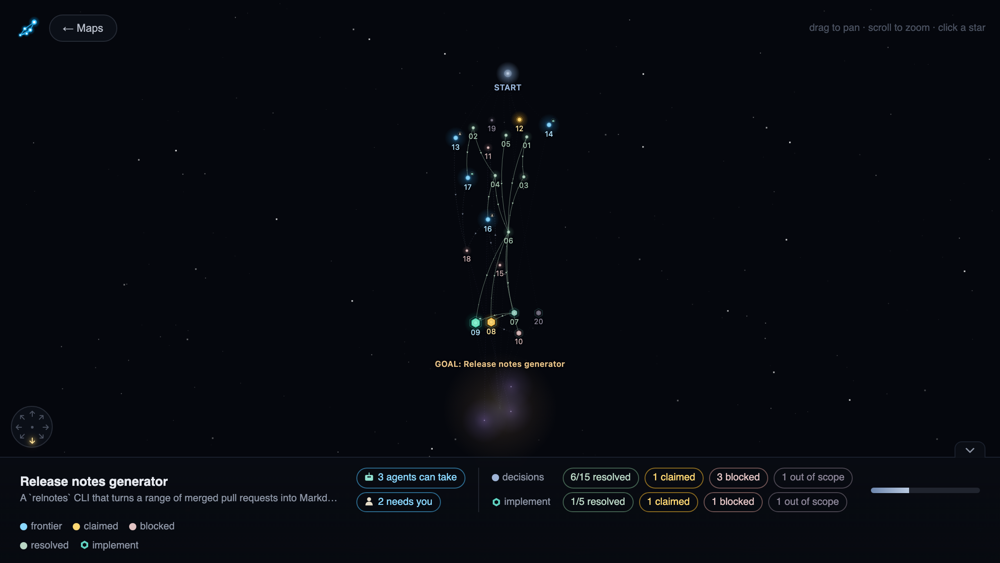
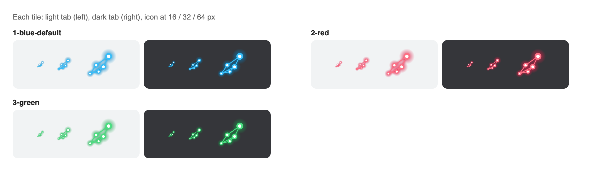

# Logo

The logo is a tiny constellation: a few glowing stars joined by thin lines, climbing from the bottom left to the top right.
It is the browser tab favicon, the logo on the splash screen and the mark in the top left corner of the map.

## The idea

- It shows what the tool is for: a star map, a constellation you can read as a plan.
- It moves from a start to an end, like a map does.
  The smallest star is the start, and the stars grow toward the finish light.
- It hints at branching dependencies on the way: the start fans out to three stars, and two of those paths meet again at the finish.
- It stays simple: five stars and six lines, so it still reads at 16 px.

## How it was made

The logo went through a few rounds of candidates before one was picked: five first, then a round of transparent glowing constellations, then ten more layouts.
It is drawn the way the viewer draws its own stars, so it looks at home next to them: a soft radial glow, a coloured disc, a white core, and a blurred halo under each thin line.

Blue is the default.
Red and green ship as spare variants, in case the logo should signal a status later, such as an error or an all-resolved map.

The files live in `cmd/wayfinder-maps/web/`: `favicon.svg` is the source, `favicon-32.png` and `favicon.ico` are the fallbacks, and `favicon-red.svg` and `favicon-green.svg` are the spares.
