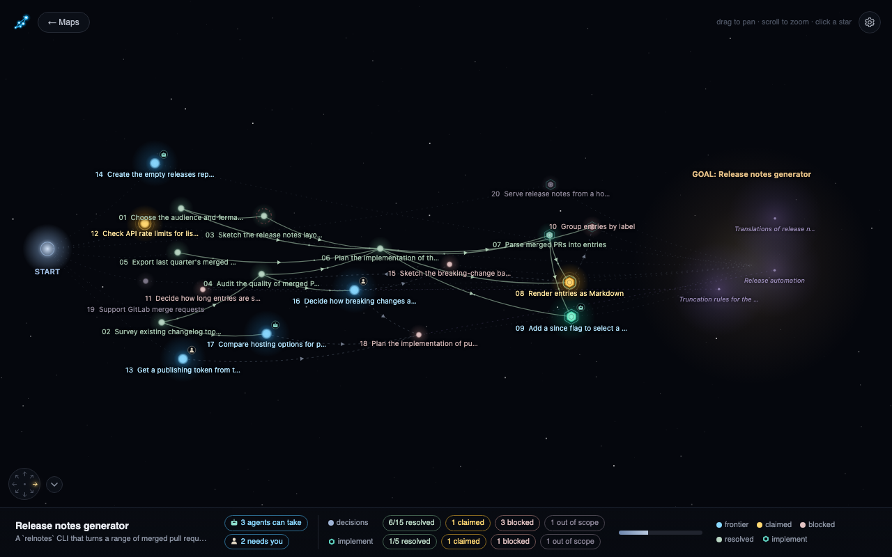
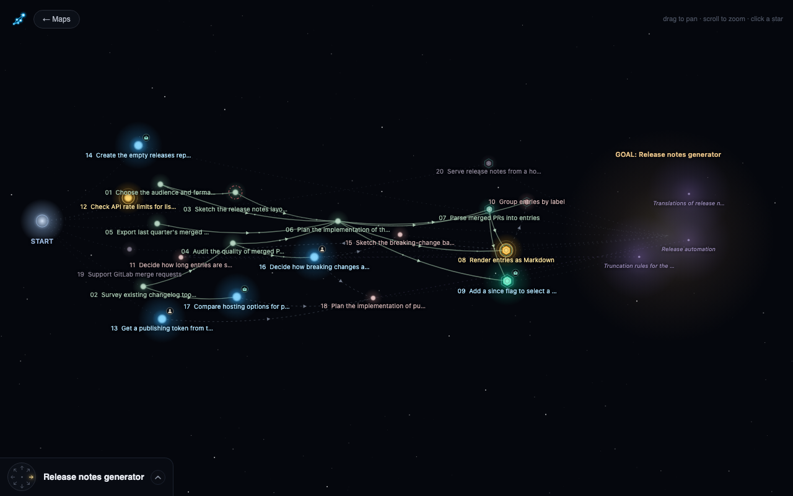
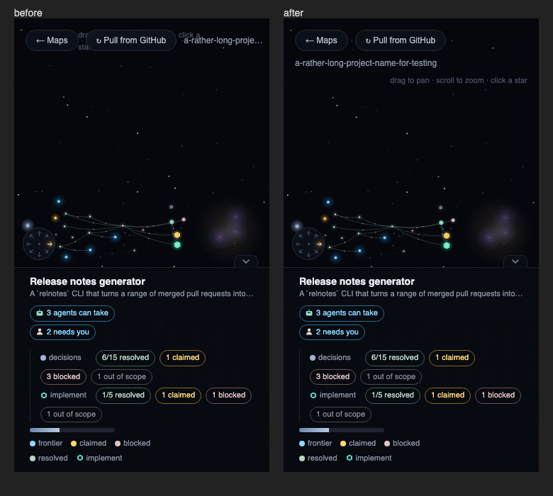

# Narrow screens

The viewer stays usable in a narrow window or a docked side panel.

## Status bar

The bottom status bar wraps onto extra rows instead of running off the edge, so the title, counts, progress bar and legend all stay visible.

## Collapsing the status bar

The small arrow on the bar collapses it into a bottom-left corner holding the map title (cut off with "..." after 24 characters) and the compass, so the map gets the full width back.
The arrow in the corner expands it again, and the choice is remembered.

## Top bar

The Maps and Refresh buttons, the project name and the hint share a single bar that wraps onto extra rows instead of overlapping, and it gives way to the detail panel when that opens.

For a tall column, point the [compass](compass.md) south.
