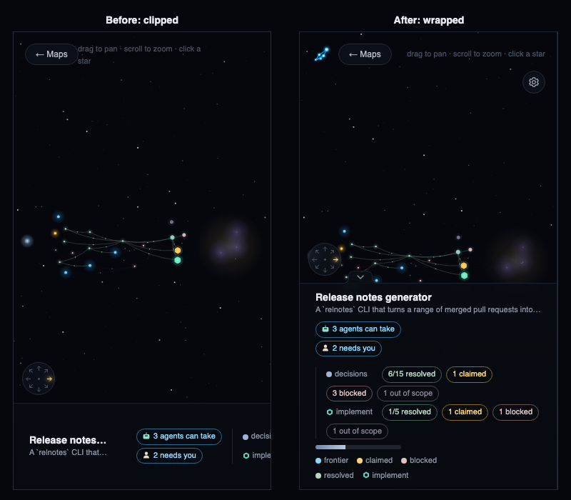
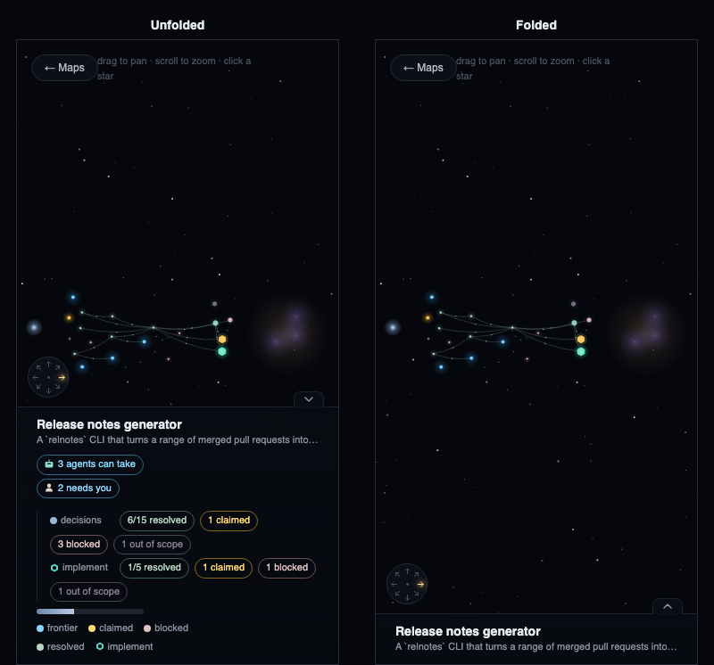
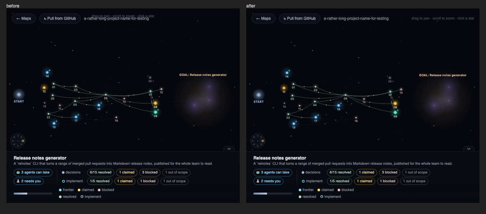

# Narrow screens

The viewer stays usable in a narrow window or a docked side panel.

## Status bar

The bottom status bar wraps onto extra rows instead of running off the edge, so the title, counts, progress bar and legend all stay visible.

The small arrow tab on the bar's top edge folds it down to just the title, and back out.

## Top bar

The Maps and Refresh buttons, the project name and the hint share a single bar that wraps onto extra rows instead of overlapping, and it gives way to the detail panel when that opens.

For a tall column, point the [compass](compass.md) south.
