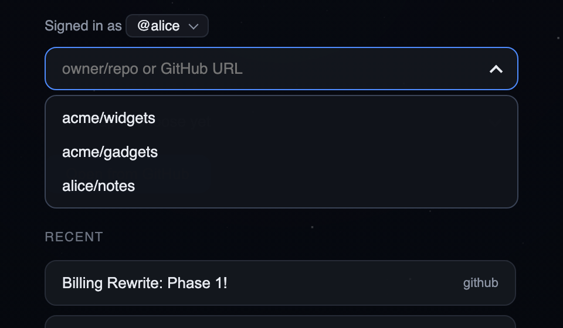
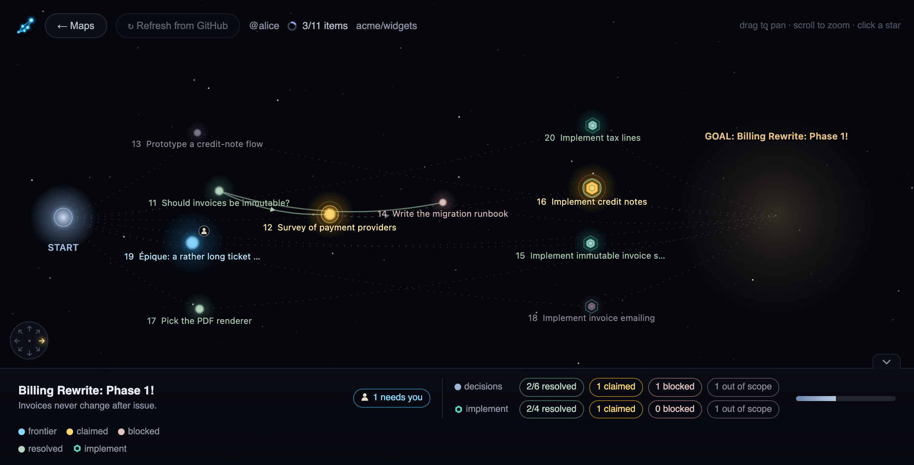
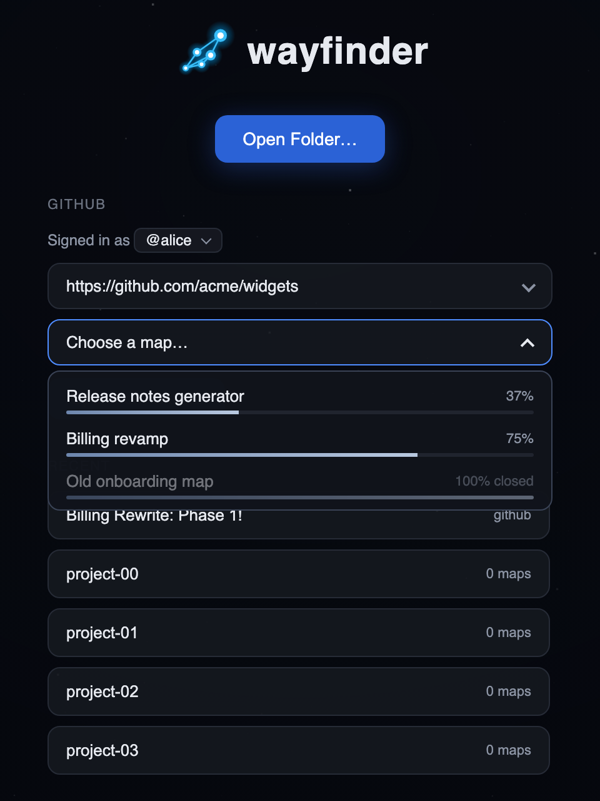
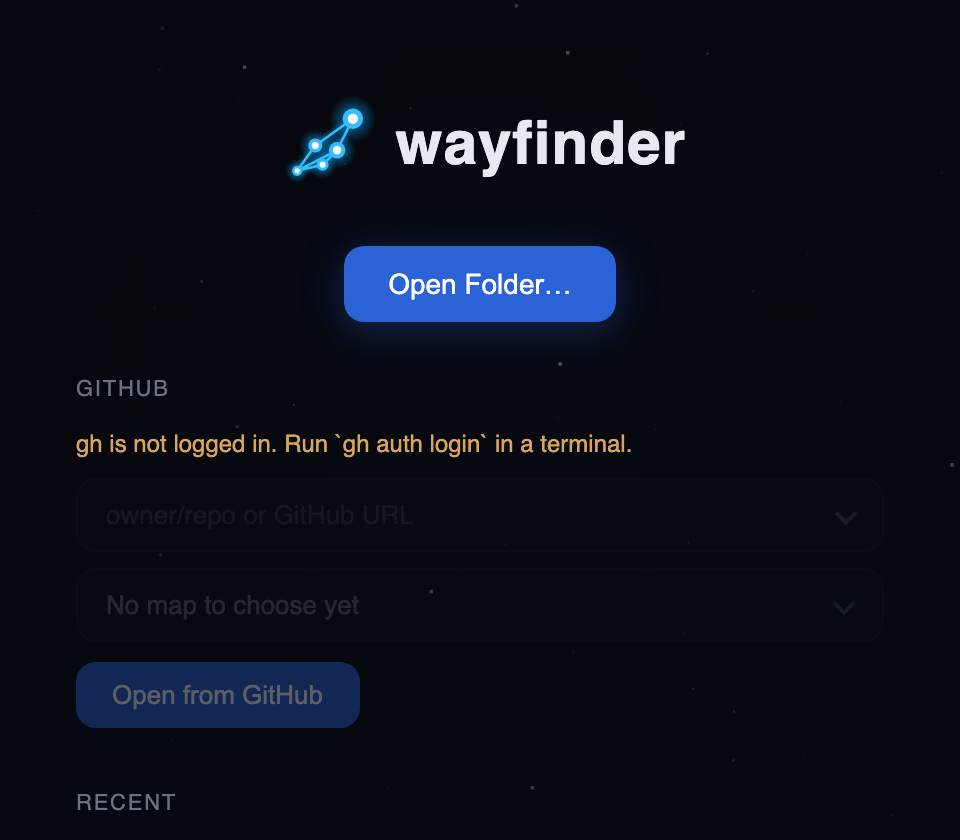
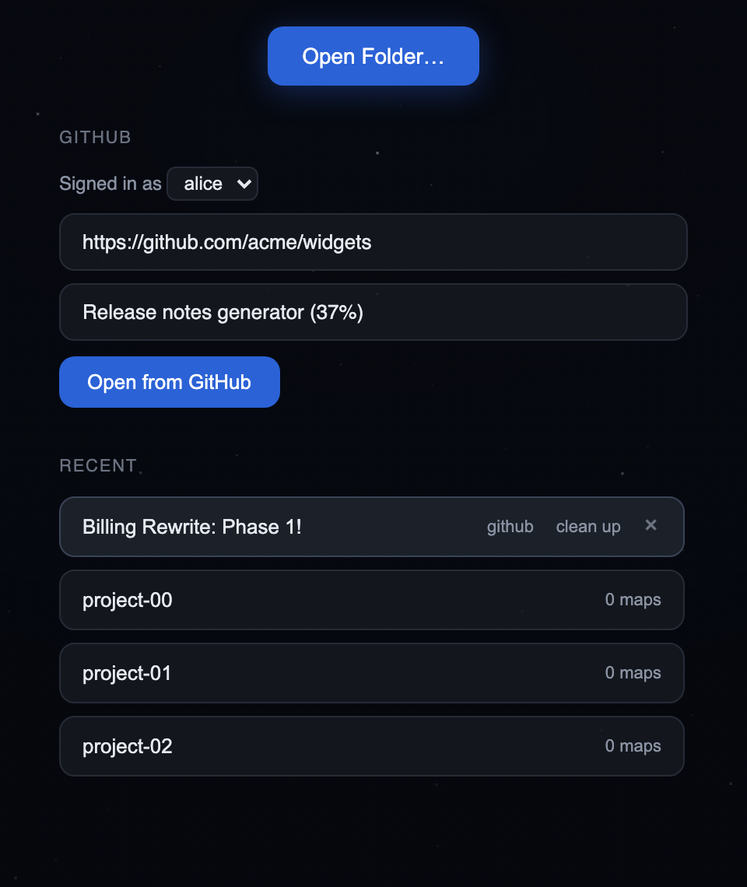
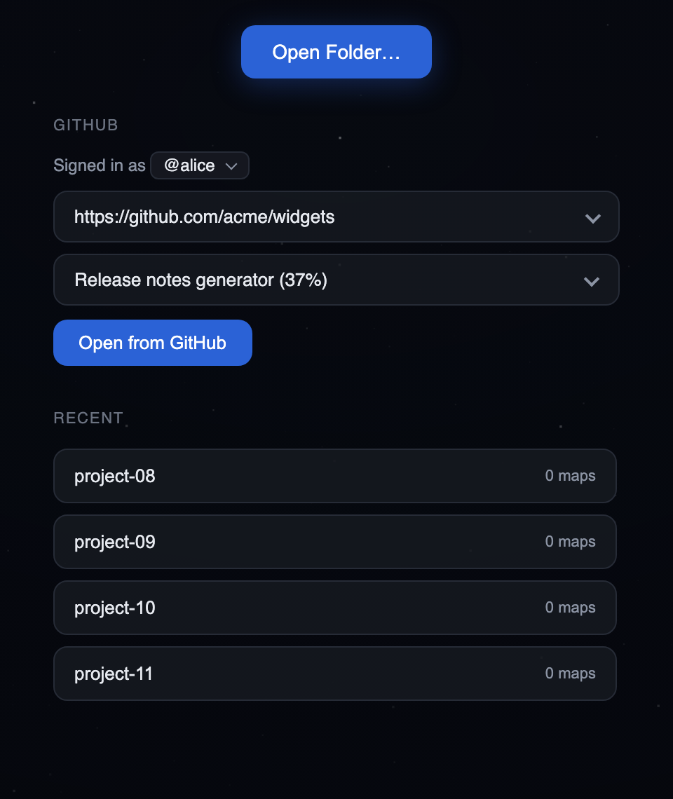
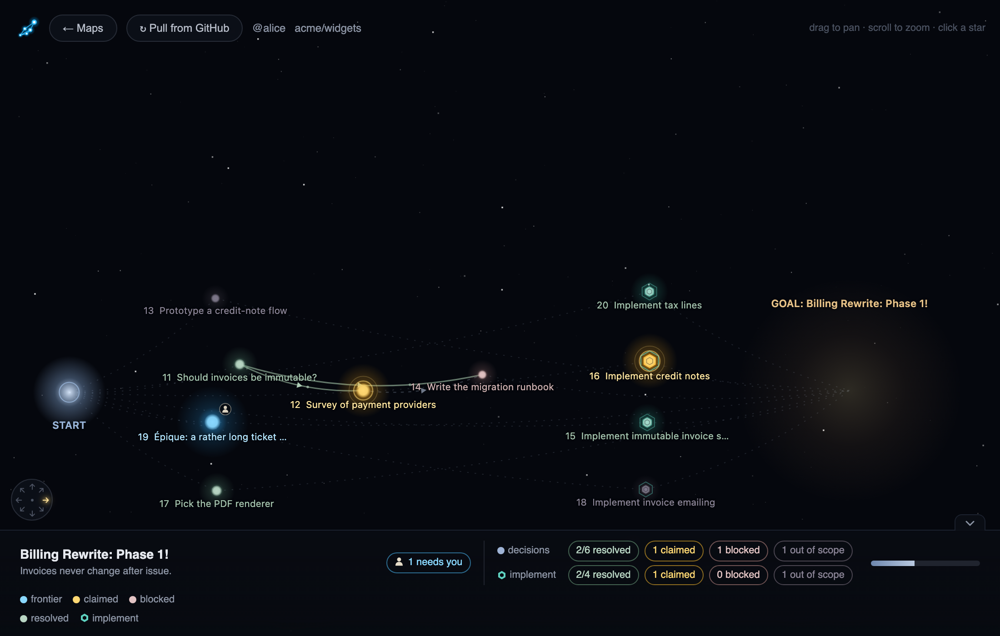

# Open a map from GitHub

A map kept as [GitHub issues](../guide/github-issues.md) opens straight from the splash, with no `pull` first.
It needs the [GitHub CLI](https://cli.github.com), logged in.

1. The splash shows the `gh` account in use, with a dropdown (the viewer's own, so it looks the same everywhere) to switch when several are logged in.
   Without `gh`, or without a login, it shows a hint (install it, or run `gh auth login`) and dims and disables the button.
2. Paste `owner/repo` or a GitHub URL into the repo box, or pick from its dropdown: the 10 repos you were most recently active in (pushes, PRs, issues, comments; stars do not count), plus repos you opened from GitHub before.
3. The repo is scanned for maps, which are issues with sub-issues where a child carries a `wayfinder:<type>` label.
   Each map shows its percent completed, and closed maps are dimmed.
   The scan reads the 100 most recently updated issues of the repo.
4. `Open from GitHub` pulls the map with the usual progress into `<user cache dir>/wayfinder-maps/github/<owner>-<repo>/<slug>`, then opens it and lists it under [Recent](recent-maps.md).
   A map already in the cache opens at once instead, and the viewer starts the same refresh as the `Refresh from GitHub` button, so you see the spinner and `N/M items` in the top bar while it updates.

{ width="420" }

{ width="720" }

{ width="420" }

{ width="420" }

The copy is a read-only mirror: nothing is written back to GitHub, and the `Refresh from GitHub` button refreshes it.
Cached maps carry a `clean up` button in Recent, next to the `x` that only forgets the entry.

{ width="420" }

{ width="420" }

