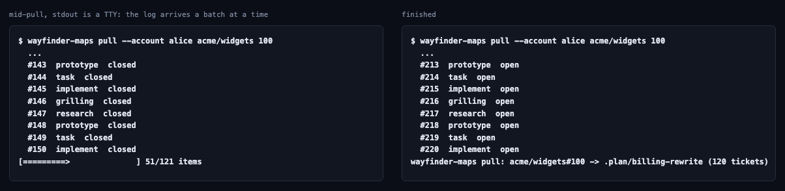
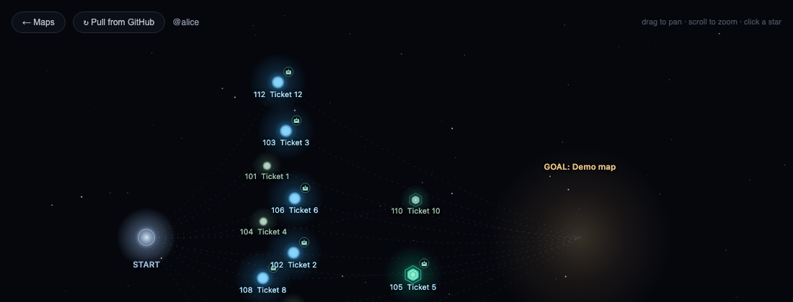
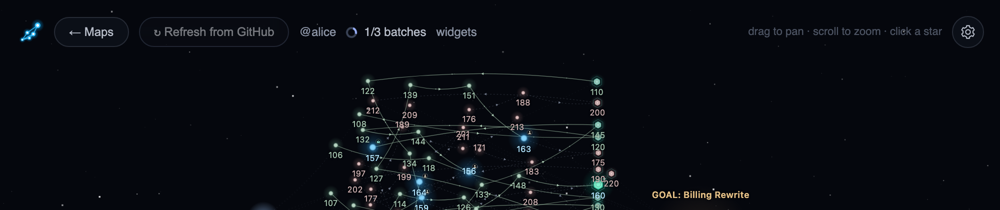
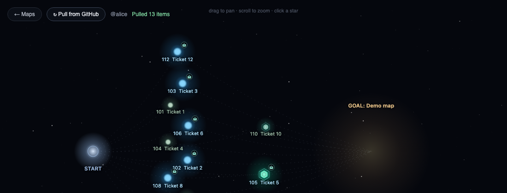
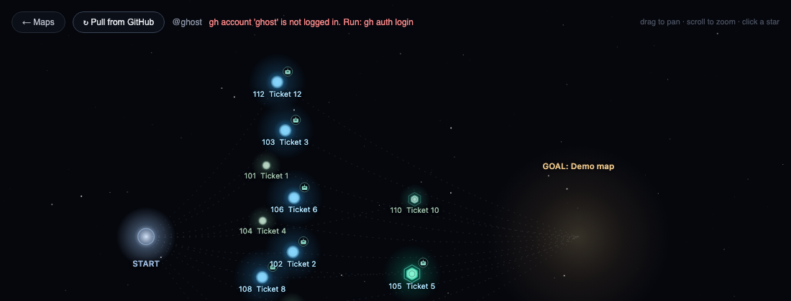

# Pull from GitHub

Upstream ships a `wayfinder-pull` script that mirrors a map kept as GitHub issues into `.plan/`.
Here it is a subcommand of the binary, with more on top:

- the `wayfinder:implement` and `wayfinder:afk` labels and the linked PRs are imported;
- `--account <gh-user>` pulls as another logged-in `gh` account, stored for later refreshes;
- a progress bar on a terminal, plain `pulled N/M items` lines in CI;
- tickets fetched [50 at a time](#fast-on-large-maps), so large maps pull in seconds.



[Maps kept as GitHub issues](../guide/github-issues.md) has the full reference.

## Fast on large maps

Upstream's script asks GitHub about one ticket at a time.
Here one GraphQL query brings 50 tickets with their comments, blockers, labels and linked PRs.

```
one at a time   map -> list -> #11 comments -> #12 blockers -> #14 blockers -> #15 PRs -> ...
batched         tickets 1-50 -> tickets 51-100 -> tickets 101-120
```

- A list that does not fit in its batch (a very long comment thread, say) is paged through, so nothing is cut off.
- Requests go out one after another, to stay gentle on GitHub's [rate limits](https://docs.github.com/en/graphql/overview/rate-limits-and-query-limits-for-the-graphql-api).
- Progress advances once per batch, so a map of up to 50 tickets finishes in one step.

## Refresh from the viewer

A Refresh from GitHub button in the top bar re-pulls the map and streams progress from the server (server-sent events) as a spinner and `N/M batches`, then the number of items refreshed, or the error message.
The account in use is shown next to the button.









To open a GitHub map without a `pull` first, see [Open a map from GitHub](open-from-github.md).
