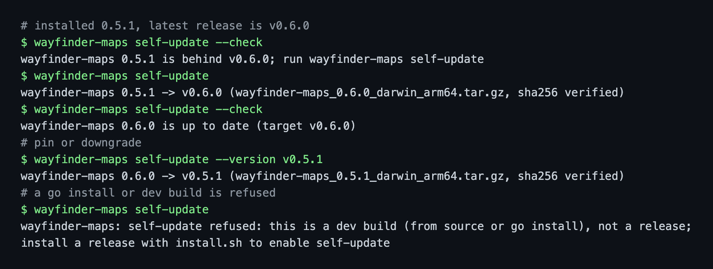

# self-update

A binary installed from a release by `install.sh` upgrades itself in place, with a sha256 check, `--check` and version pinning.

```sh
wayfinder-maps self-update                    # latest release
wayfinder-maps self-update --version v0.5.1   # pin or downgrade
wayfinder-maps self-update --check            # report only, exit 1 if behind
```



A Homebrew install is [upgraded by Homebrew](../install.md#homebrew): `self-update` is hidden from `--help` there and refuses with `brew upgrade wayfinder-maps`.

Behind a release, other commands point here with an [outdated notice](update-notice.md).

[Install](../install.md#updating-the-binary) has the details, including which builds it refuses.
