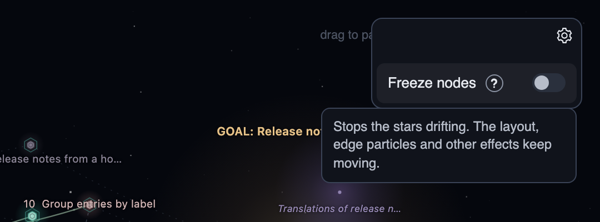

# Settings menu

The gear button at the right end of the top bar opens a small popover for viewer toggles.
It unfolds out of the gear, and folds back into it when closed.
Click outside it or press Escape to close it.


## Settings

| Setting | What it does |
| --- | --- |
| [Freeze nodes](freeze-nodes.md) | Stops the idle drift of the stars |

The [compass](compass.md) direction is saved with the same settings but lives on the map, not in this menu.

## Notes on hover

Each setting has a small `?` next to its name.
Hover or focus it for a note on what the setting does.



## Where settings are saved

Settings live in `settings.json` in the `wayfinder-maps` folder of your user config directory (on macOS, `~/Library/Application Support/wayfinder-maps/`), next to `recents.json`.
They are kept in a file rather than the browser because app mode picks a random port, which would look like a new site every time.
A missing or invalid file falls back to the defaults.

```json
{
  "direction": "E",
  "freezeNodes": false
}
```
