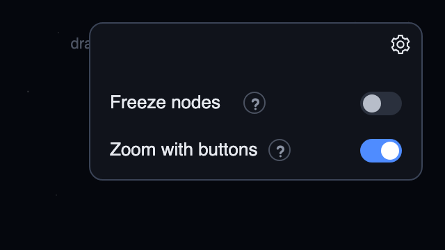
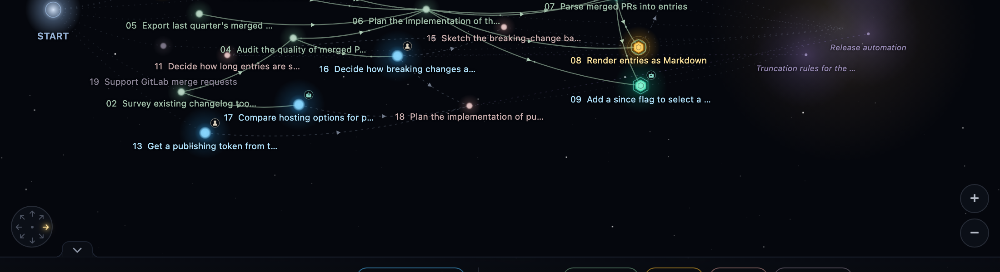
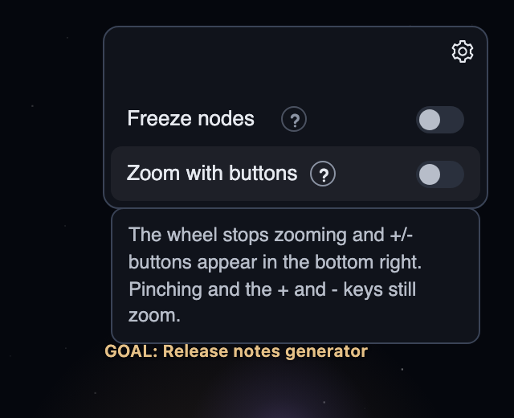
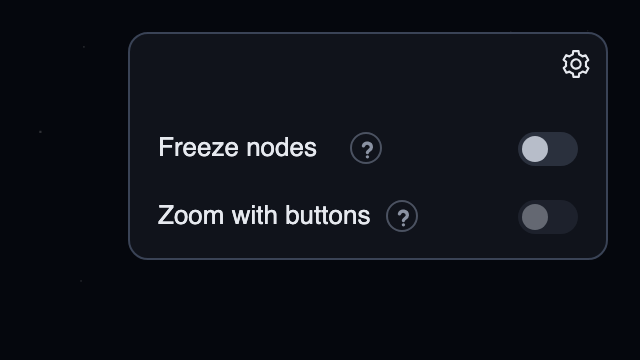
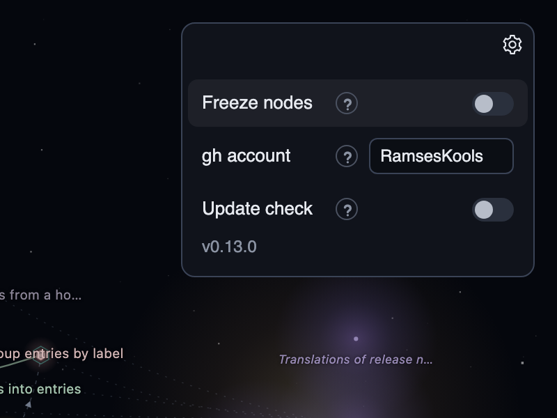
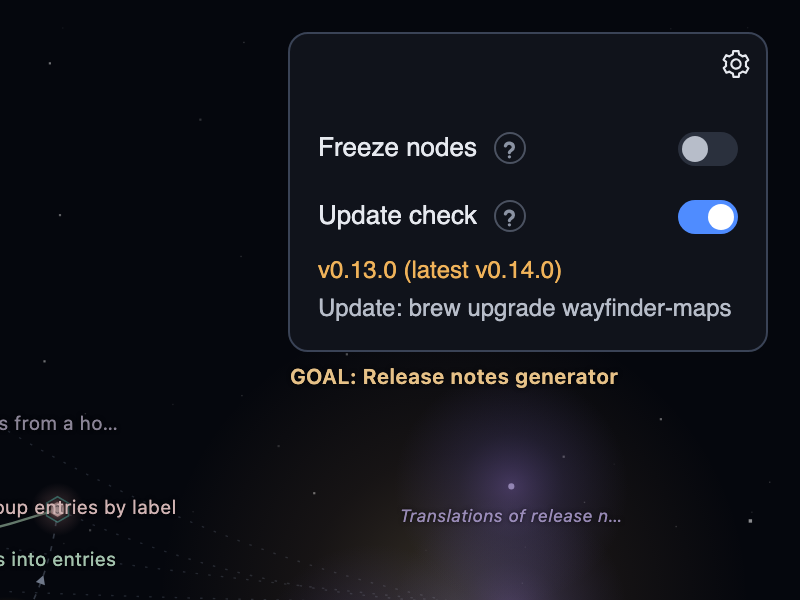
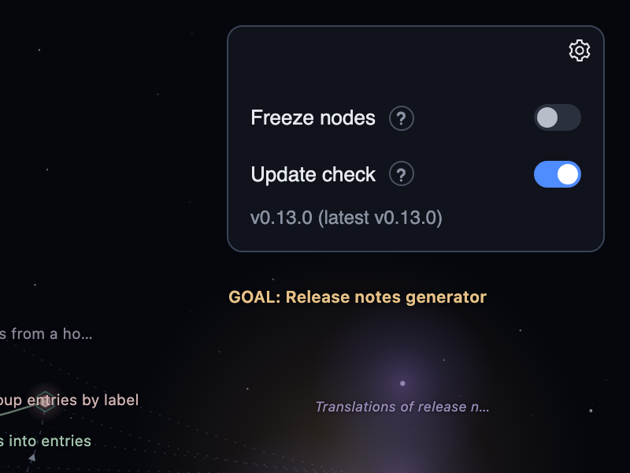
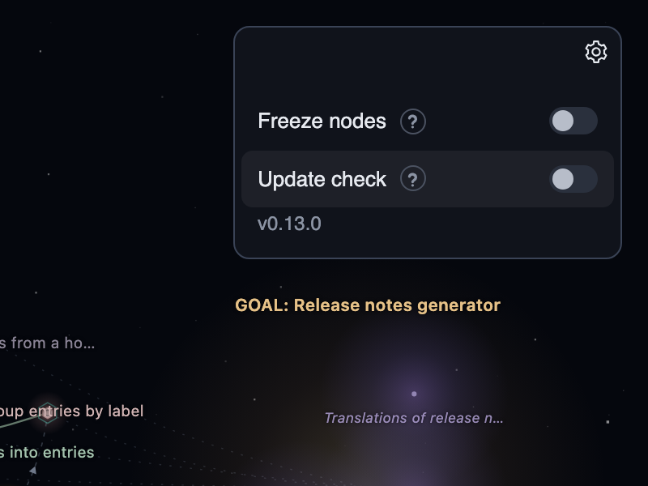

# Settings menu

The gear button at the right end of the top bar opens a small popover for viewer toggles.
It unfolds out of the gear, and folds back into it when closed.
Click outside it or press Escape to close it.


Each setting has a small `?` next to its name.
Hover or focus it for a note on what the setting does.


## Freeze nodes

Stars drift by a couple of pixels so the map feels alive, which some people find distracting.
This switch stops that drift.


Freezing only removes the idle drift.
The layout is unchanged, and everything else keeps moving: flow particles on edges, the frontier pulse, claimed rings, the undermined halo, status flares, grow-in and the glide to new positions after a live update.

## Zoom with buttons

Scrolling a page that embeds a map is annoying: when the cursor lands on the map, the wheel zooms the map instead of scrolling the page.
This switch is off by default, so the wheel zooms as usual.



Switched on, the wheel stops zooming, and a + and a - button appear in the bottom right corner of the map.
The hint in the top bar changes to "press +/- to zoom".



- Pinching on a touch screen or a trackpad still zooms, as do the `+` and `-` keys, so neither needs a button.
- The buttons sit beside the ticket panel when it is open, and the keys are ignored while you type in a field.
- It works in the app, `serve` and every [export](export.md), where it is kept in the browser's `localStorage`.



### Overriding it from the address

`?zoom=buttons` on the viewer's address forces the buttons and `?zoom=wheel` forces scroll-zoom, for that page load only.
It never changes the saved setting, so an embed can choose without touching what a reader picked, which is how the [demo](../demo.md) and the home page embed the map.
The switch is greyed out while an override is in force.
Freeze nodes and the compass have the same kind of override, see [Overrides from the address](#overrides-from-the-address).



## gh account

The default `gh` account for [`pull`](pull.md) and [Open from GitHub](open-from-github.md).
Leave it empty to use the active `gh` account.



It is saved when you leave the field or press Enter, and a name that is not a GitHub login turns the field red and is not saved.
`--account`, the account stored in a pulled map and the `WAYFINDER_GH_ACCOUNT` environment variable all beat it, see [Configuration](../configuration.md).

## Update check

The switch turns the [outdated notice](update-notice.md) on or off, for the CLI and the viewer alike.
Below it the menu shows the running version and the latest release, plus the update command when you are behind.





With the check off, the menu shows only the running version.



The latest version comes from the server's cached lookup, so opening the menu, flipping the switch or reloading the page makes no new request to GitHub.

## Overrides from the address

An embed can pick how the map starts with query parameters on the viewer's address, without touching what a reader saved.
They work in the app, `serve` and every [export](export.md), and combine with `&`.

| Parameter | Values | Overrides |
| --- | --- | --- |
| `zoom` | `buttons`, `wheel` | [Zoom with buttons](#zoom-with-buttons) |
| `freeze` | `on`, `off` | [Freeze nodes](#freeze-nodes) |
| `compass` | `N`, `NE`, `E`, `SE`, `S`, `SW`, `W`, `NW`, `none` | The [compass](compass.md) direction, `none` being the radial layout |

```html
<iframe src="my-map/?zoom=buttons&freeze=on&compass=S" style="width:100%;height:600px;border:0" title="My wayfinder map"></iframe>
```

- An override lasts for that page load only and is never saved.
- The Freeze nodes and Zoom with buttons switches are greyed out while overridden.
- The compass stays usable, but a direction picked under `?compass=` is not saved either.
- A missing or unknown value is ignored, so the saved setting or the default applies.

## Where settings are saved

Settings live in `settings.json` in the `wayfinder-maps` folder of your user config directory (on macOS, `~/Library/Application Support/wayfinder-maps/`), next to `recents.json`.
They are kept in a file rather than the browser because app mode picks a random port, which would look like a new site every time.
A missing or invalid file falls back to the defaults.
The [compass](compass.md) direction is saved there too, but is set from the compass on the map, not from this menu.
In a static [export](export.md) there is no server, so Zoom with buttons, Freeze nodes and the compass direction are kept in the browser's `localStorage` instead.

```json
{
  "direction": "E",
  "freezeNodes": false,
  "updateCheck": true,
  "ghAccount": "",
  "zoomButtons": false
}
```

The [Configuration](../configuration.md) page lists every key and environment variable.
