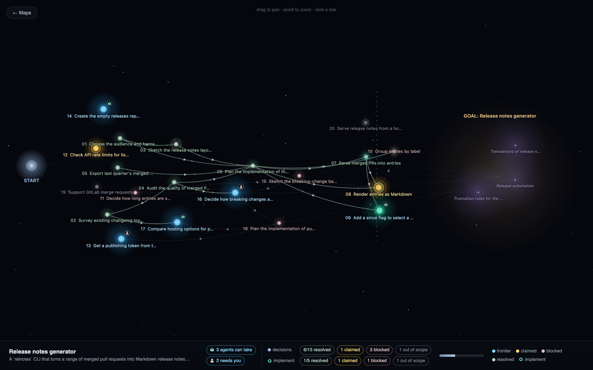

# Start and goal

The viewer gives the map a beginning and an end.
A virtual start node sits before every ticket without blockers, and a goal cloud at the far end holds the fog: the parts of the effort not yet specified.
The map reads as a journey from where you are to where you are going, with the tickets in between.

The [compass](compass.md) sets which way the journey runs, and [ticket placement](ticket-placement.md) decides where each ticket sits.
