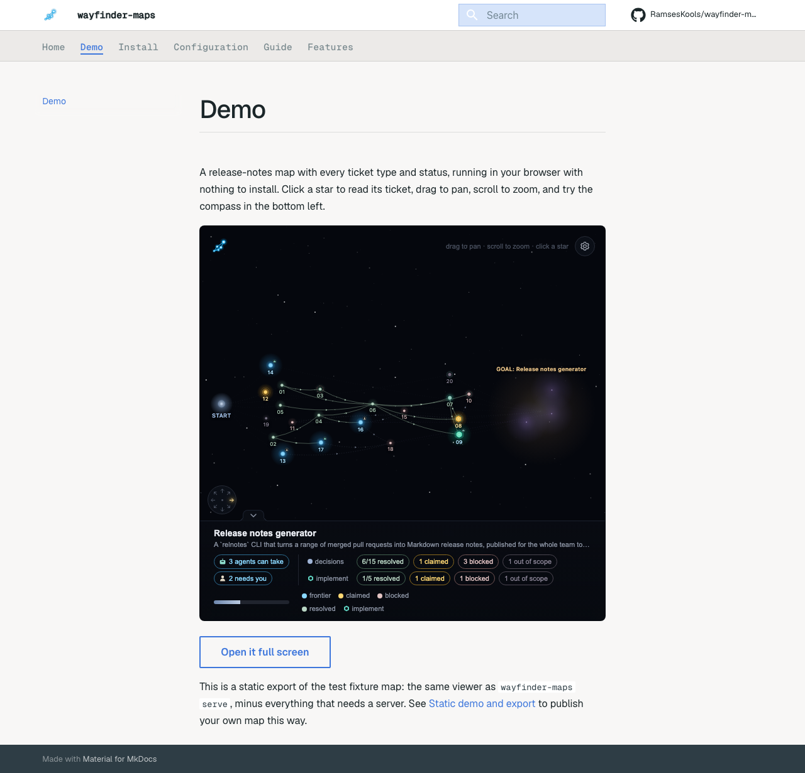

# Static demo and export

`wayfinder-maps export <map-dir> <out-dir>` writes a map as a self-contained static site: the viewer plus a `graph.json` snapshot of the map.
Serve `<out-dir>` from any file server, no `wayfinder-maps` binary needed:

```sh
wayfinder-maps export .plan/my-effort site
python3 -m http.server -d site
```

The docs site uses it for the [live demo](../try.md): the `docs` job in `ci.yml` and `release.yml` exports the test fixture `internal/wayfinder/testdata/implement-demo` into `site/demo/` after `mkdocs build`.




## What changes in the exported viewer

The page carries a `<meta name="wayfinder-static">` flag.
When it is there, the viewer:

- Loads `graph.json` instead of asking a server, and never polls for changes.
- Hides what needs a server: Open Folder, recent maps, Open from GitHub, Refresh from GitHub and the back to Maps button.
- Keeps the [compass](compass.md) direction and Freeze nodes in the browser's `localStorage`, and hides the gh account and update check rows of the [settings menu](settings.md).

The `serve` and `app` viewer is unchanged.

## Notes

- The export is a snapshot: re-run it to pick up edits to the map.
- It includes every ticket's text, so only export maps you are happy to publish.
- `<out-dir>` is created if needed and files in it are overwritten.
  It cannot sit inside the map directory.
- Running `mkdocs serve` locally does not include the demo, only the full docs build does: `uv run mkdocs build --strict`, then `wayfinder-maps export internal/wayfinder/testdata/implement-demo site/demo`.
