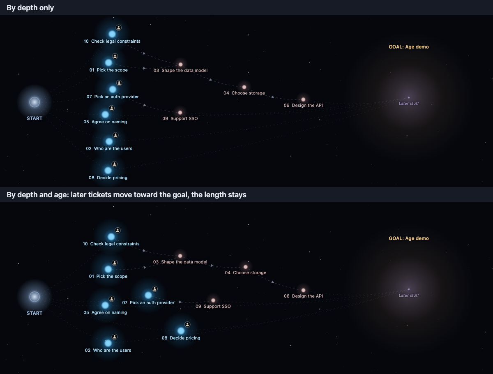
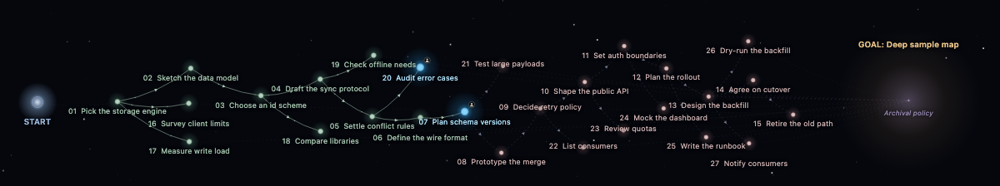

# How tickets are placed

Along the flow, a ticket's place comes from what blocks it and when it was created.
Across the flow, a small physics simulation spreads the tickets out.
The examples here flow east, and the [compass](compass.md) can point that flow any of 8 ways.
Its 9th option, no direction (the centre button), switches to a [radial layout](#radial-layout) with rings instead of columns, and no start or goal.

## Depth sets the column

- A ticket without blockers has depth 0, next to the [start](start-and-goal.md).
- Any other ticket sits one past its deepest blocker.
- So the longest chain of blockers sets how long the map is.

## Age nudges it forward

By depth alone, a ticket without blockers sits next to the start, even when it was added weeks into the effort.
So creation order nudges later tickets toward the goal:

- Tickets are grouped in waves, and a new wave starts after an hour without a new ticket.
  Only the order of waves counts, so a week's break counts the same as an afternoon's.
- Each wave aims up to half a column further than the one before, less when there are many waves.
- A ticket only moves within its slack: the room it has before something it unblocks would have to move.
  So age doesn't stretch the map, except that a map less than 2 columns long can spread to 2.
- A ticket's column stays at least one past each of its blockers.

The creation time comes from the issue for a map pulled from GitHub (saved as `created:` in the mirrored ticket), else the commit that first added the ticket file, else the file's creation time.

## Columns narrow with depth

The first gap between columns is 190 wide, each next one is 20 narrower, and none goes below 100.
So long chains stay compact and fit the screen at a larger zoom.
A ticket that age puts between two columns lands proportionally within that gap.

## Physics spreads the rest

The viewer runs a small force-directed simulation:

- Every pair of tickets pushes apart.
- Each blocker arrow works like a spring, pulling or pushing its two tickets toward a comfortable distance.
- Each ticket is pulled toward its column, and weakly toward the map's centre line.

So across the flow (up and down on an east map), neither age nor ticket number decides where a ticket goes.
Columns are a pull rather than a grid, so a ticket can sit a little off its own.

- The layout is repeatable: with a fixed random seed and number of steps, an unchanged map looks the same every time you open it.
- While a map is open, existing tickets stay put and only new ones are settled around them.
  Reopening lays out the whole map afresh, so tickets can shift then.
- The stars also bob gently in place, which [Freeze nodes](settings.md) stops.

## Implement tickets

[Implement tickets](implement-tickets.md) get their own belt past the last decision column.
Depth and age order them among themselves, in more tightly packed columns.
The belt sits past every decision, so an arrow from an implement ticket to a decision it blocks points backward.

## Radial layout

With the [compass](compass.md) set to no direction, columns become rings around the centre.
Depth and age pick the ring, and physics spreads the tickets around it.
Rings stay evenly spaced, since the outer ones need the room, and the implement belt becomes an outer ring.
