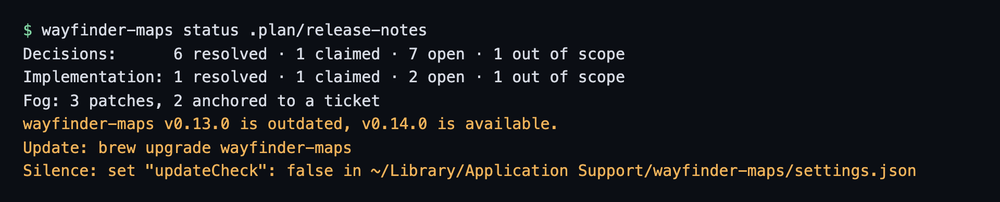

# Outdated notice

When a newer release exists, the CLI ends with a short notice on stderr and the viewer's settings menu shows the same news.



## In the terminal

- The notice names the update command for the way you installed the binary: `wayfinder-maps self-update` for `install.sh`, `brew upgrade wayfinder-maps` for Homebrew, `go install ...@latest` for `go install`, and the Releases page for a manual download.
- A `dev` build never checks.
- It goes to stderr, so piped or parsed stdout stays clean, and it never changes the command's exit code.
- It shows only when stderr is a terminal and `CI` is unset, so agents calling `status` or `lint` stay quiet.
- `self-update` and `--version` skip it, they already say it.
- `serve` and `app` print it as soon as the lookup finishes, since they run until you stop them.

## How it checks

- It asks the same place as [`self-update --check`](self-update.md), so `WAYFINDER_RELEASES_URL` applies.
- The answer is cached for 24 hours in `latest-release.json` in the `wayfinder-maps` folder of your user cache directory, shared by the CLI and the viewer.
- Within the cache window there is no network call at all.
- A failed lookup (offline, rate limited) is silent and not retried for an hour.
- The lookup runs beside the command and times out after 2 seconds, so it never delays or changes the command's own result.

## Silence it

The notice names the file to edit, so silencing it needs no docs:

```
Silence: set "updateCheck": false in ~/Library/Application Support/wayfinder-maps/settings.json
```

- Set `"updateCheck": false` in `settings.json` in the `wayfinder-maps` folder of your user config directory (the notice prints the full path), or flip the Update check switch in the viewer's [settings menu](settings.md#update-check).
- Either way it turns off both the check and the notice.
- If the file does not exist yet, create it with just `{"updateCheck": false}`, missing keys keep their defaults.
