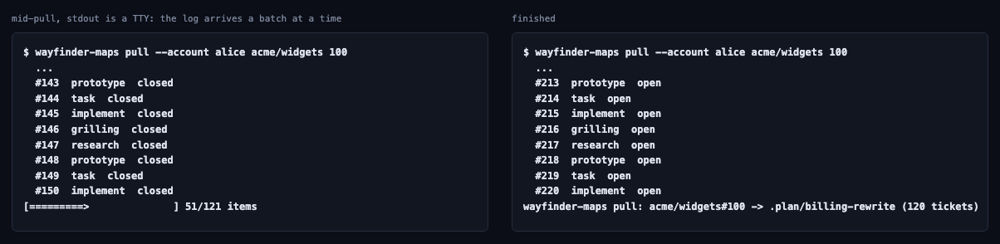

# Maps kept as GitHub issues

The wayfinder skill is tracker-agnostic: the same method can leave its map in an issue tracker rather than in `.plan/`.
`wayfinder-maps pull` mirrors such a map back into the local layout, so `status`, `lint` and the viewer read it with no change to the reader; the tool still only knows about files.
The viewer can also [open a map from GitHub](../features/open-from-github.md) straight from the splash.

```
wayfinder-maps pull [--account <gh-user>] [-q] <owner/repo> <map-issue-number> [out-dir]
wayfinder-maps pull [--account <gh-user>] [-q] --refresh <out-dir>
```

It is built into the binary, so a [release install](../install.md) can pull right away.
The default out-dir is `.plan/<slug of the map's title>`, wiped and rewritten on each run.
It is a cache, not a source, so nothing in it should be hand-edited and the directory belongs in the host repo's `.gitignore`.
A pull that fails part way leaves the previous mirror untouched.

## Prerequisites

`pull` needs the [GitHub CLI](https://cli.github.com) (`gh`) installed and logged in.
There is no token to configure and no `jq` or `bash`.
The rest of wayfinder-maps works without `gh`.

```
gh auth login      # once
gh auth status     # which account is active, and whether it is logged in
```

The account must be able to read the repo and its issues.
If not, `pull` stops before touching anything and says what to do:

```
$ wayfinder-maps pull acme/widgets 10      # gh not installed
wayfinder-maps pull: gh is not installed or not on PATH. Install it from https://cli.github.com, then run: gh auth login
$ wayfinder-maps pull acme/widgets 10      # gh not logged in
wayfinder-maps pull: gh is not logged in. Run: gh auth login (or set GH_TOKEN)
$ wayfinder-maps pull acme/secret 10       # no access to the repo or issue
wayfinder-maps pull: cannot read repos/acme/secret/issues/10 as gh account 'alice' (HTTP 404). Check the repo name and issue number, and that this account can see the repo; check with: gh auth status
```

These exit with code 2.
In the viewer the same message shows when a refresh fails.

```
$ wayfinder-maps pull acme/widgets 10
  #11  grilling  closed
  #12  research  open  @alice
  #13  prototype  closed
  #14  task  open
wayfinder-maps pull: #15 links more than one PR; using https://github.com/acme/widgets/pull/51
  #15  implement  closed
  #16  implement  open  @bob
  #17  grilling  closed
  #18  implement  closed
  #19  grilling  open
  #20  implement  closed
wayfinder-maps pull: acme/widgets#10 -> .plan/billing-rewrite-phase-1 (10 tickets)
$ cat .plan/billing-rewrite-phase-1/.source.json
{
  "repo": "acme/widgets",
  "map": 10,
  "auth": "gh",
  "account": "alice"
}
$ wayfinder-maps pull --refresh .plan/billing-rewrite-phase-1 | tail -1
wayfinder-maps pull: acme/widgets#10 -> .plan/billing-rewrite-phase-1 (10 tickets)
```

## Choosing the gh account

By default a pull runs as the active `gh` account.
`--account <gh-user>` (or `WAYFINDER_GH_ACCOUNT`) pulls as another logged-in account, using that account's token (`gh auth token --user`), even if the active one has no access to the repo.
An account that is not logged in stops the pull before it touches GitHub or the mirror (exit 2).

Each pull writes `<out-dir>/.source.json` (repo, map issue, `gh` auth kind and account).
`wayfinder-maps pull --refresh <out-dir>` re-pulls from it with the stored account, even if the active `gh` account has changed since; `--account` on a refresh switches the stored account.
An explicit `--account` beats the stored one, which beats `WAYFINDER_GH_ACCOUNT`.
Maps pulled before `.source.json` existed need one manual pull to get the file.

```
$ gh auth status | grep -E "account|Active"      # bob is active, alice has access
$ wayfinder-maps pull acme/secret 10
wayfinder-maps pull: cannot read repos/acme/secret/issues/10 as gh account 'bob' (HTTP 404). ...
$ wayfinder-maps pull --account ghost acme/secret 10
wayfinder-maps pull: gh account 'ghost' is not logged in. Run: gh auth login
$ wayfinder-maps pull --account alice acme/secret 10
```

## Progress

On a terminal, `pull` draws a progress bar with `N/M items` below the per-ticket log.
Off a terminal (CI, pipes), it prints plain `pulled N/M items` lines instead.
The total moves: it is 1 until the sub-issues are listed, then the ticket count plus the map issue.
`-q`/`--quiet` silences the bar and the lines (the per-ticket log stays).



```
$ wayfinder-maps pull --account alice acme/secret 10 | cat
  #11  grilling  closed
pulled 1/6 items
...
pulled 6/6 items
```

The viewer shows the same progress, see [Pull from GitHub](../features/pull.md).

## How issues map to tickets

The mapping follows the GitHub adapter in the skill's setup notes.
Two adjustments make the round trip parse:

- Headings inside a resolve comment are demoted one level, since a comment opening with its own `##` would otherwise end the `## Answer` section before any prose landed and leave the ticket unresolved.
- The map body's ticket references (issue URLs) are rewritten to `./tickets/NN-<slug>.md`, which is the only form Decisions-so-far is scanned for.
  `## Decisions so far`, `## Implemented so far` and `## Out of scope` are generated only when the map body carries no section of that name.

The label `wayfinder:implement` makes a ticket `type: implement`, and `wayfinder:afk` writes `afk: true` (meaningful on a task only).
For an implement issue `pull` reads its linked pull requests and writes `pr: <url>`, preferring a merged one; more than one linked PR prints a warning, since an implement ticket usually ships one PR.
A closed implement issue with no comment gets the answer `Shipped in <PR url>.` when a PR was found, else `_Closed on GitHub with no answer comment._`; either way it is listed under Implemented so far rather than Decisions so far.

The mirror is one-directional and is a snapshot: claiming or resolving in the viewer changes nothing in the tracker, and a change made there shows up on the next pull.
`undermined_by` has no GitHub representation, so a mirrored map never paints an undermined node.
