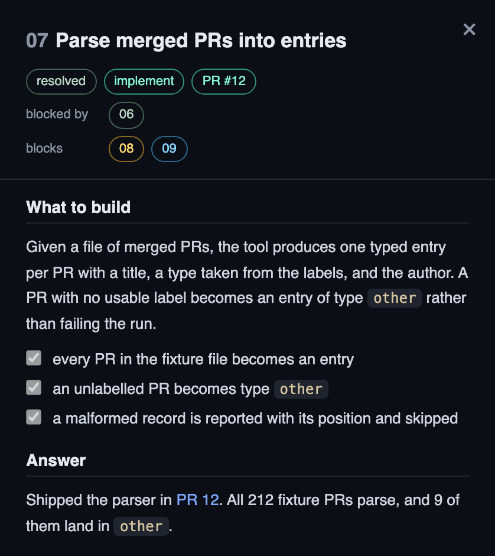
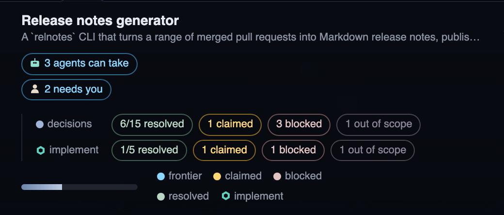

<div class="hero" markdown>

# Nothing is too big to plan

Chart work too big for one agent session, then build it, all on one star map.
{ .hero__tagline }

<div class="hero__buttons" markdown>
[Try the demo](#try-it){ .md-button .md-button--primary }
[Install](#install){ .md-button }
</div>

</div>

{ .hero__image }

## Why this tool

<div class="cards" markdown>

- Plan and build work too big for one agent session.
- See the whole effort at a glance: decisions, dependencies, progress, and the fog that is left.
- Carry the map from the first question to the merged PRs.
- A CLI for agents, a star map for humans.

</div>

## Why wayfinder maps

Agents start every session with no memory, and big ideas start foggy: you can name the destination, but not yet the route.
A wayfinder map is the shared memory in between.
It holds one ticket per open question, and each session resolves one, until the route is clear.

The method is [Matt Pocock's](https://github.com/mattpocock), and he and others explain it better than I can:

<div class="sources" markdown>

- [Matt's wayfinder doc](https://github.com/mattpocock/skills/blob/main/docs/engineering/wayfinder.md): "an idea whose destination you can name but whose route you cannot yet see."
- [Matt's video, "/wayfinder: Nothing is too big to plan anymore"](https://www.youtube.com/watch?v=F3lL98Pj90o), the quick way in.
- [Latent Space interview with Matt](https://latent.space/p/wayfinder-skill): "you can't quite decide everything right at the start."
- [Context Studios](https://www.contextstudios.ai/blog/navigating-the-fog-of-war-matt-pocock-s-wayfinder-skill-2): with AFK agents running the execution, planning is the bottleneck.
- [Pasquale Pillitteri](https://pasqualepillitteri.it/en/news/12137/wayfinder-claude-code-skill-plan-big-projects): "Wayfinding means finding the way, not charging toward the goal."
- [Anthropic on long-running agents](https://www.anthropic.com/news/effective-harnesses-for-long-running-agents): "each new session begins with no memory of what came before."

</div>

## See it

Text is not the best format for a human to grasp a complex problem quickly, a picture is.
The star map shows the state of the work: what depends on what, what is done, and how far it is to the goal.

<div class="flow">
  <div class="flow__node"><strong>Your agents</strong><span>work the map through the CLI</span></div>
  <div class="flow__link"></div>
  <div class="flow__node flow__node--map"><strong>The map</strong><span>your GitHub issues, or Markdown files in <code>.plan/</code></span></div>
  <div class="flow__link"></div>
  <div class="flow__node"><strong>You</strong><span>follow along in the star map</span></div>
</div>

The map lives in your GitHub issues or in local Markdown files, and your agents update it while they work.
The CLI suits agents and the star map suits humans, so each side gets the format it reads best.
Other ticketing systems could be a backend too, vote on the [issues](https://github.com/RamsesKools/wayfinder-maps/issues) if you want yours.

## Build it

Wayfinding carries on into implementation.

I work in Data and AI, where plans change while you build.
Matt's approach stops once the way is clear, so this fork makes a small adjustment: implementation goes on the map too.
If you are like me and often hit new problems during implementation, and have to go back to the drawing board to restructure or re-plan, this way of working fits much better.
Keeping implementation on the map also allows for much bigger plans and more ambitious goals.

<div class="cards" markdown>

- Big implementations span many sessions, so they deserve the same visual tracking.
- Building a big topic turns up more fog, so research, investigation, grilling and prototyping live on the same map, next to the build tickets.
- Every ready ticket is marked AFK (an agent can take it alone) or HITL (it needs you).
- Maps can get much bigger, including implementations across multiple repos.

</div>

See [fork vs upstream](features/fork-vs-upstream.md) for everything the fork adds.

## How it works

Scroll on and watch a map go from fog to done.

<section class="story" markdown>

<div class="story__chapters" markdown>

<div class="story__chapter" markdown>
### Start with the fog

You know the destination, you cannot see the route.
Questions hide in the fog, and one agent session cannot hold them all.
</div>

<div class="story__chapter" markdown>
### Chart it

Ask your agent to run `/wayfinder-maps` on the big, foggy effort.
It writes a map and one ticket per open question, as Markdown or as GitHub issues, and wires up what depends on what.

```
.plan/release-notes/
  map.md          destination, decisions, fog
  tickets/
    01-audience-and-format.md
    07-parse-prs-into-entries.md
    ...
```
</div>

<div class="story__chapter" markdown>
### Resolve one at a time

Each session claims one ticket from the frontier and resolves it: a decision, some research, a prototype.
Every ready ticket says whether an agent can take it alone (AFK) or needs you (HITL), so you always know who is next.
</div>

<div class="story__chapter" markdown>
### Build on the same map

Implementation tickets join the map once the way is clear.
They carry their acceptance criteria and a link to the PR, and new questions found while building land on the same map.


</div>

<div class="story__chapter" markdown>
### Follow along

Watch the fog clear from the terminal or the star map.
The status bar counts decisions and implementation apart, and says how many tickets an agent can take and how many need you.



```console
$ wayfinder-maps status .plan/release-notes
Release notes generator
Decisions:      6 resolved · 1 claimed · 7 open ...
Implementation: 1 resolved · 1 claimed · 2 open ...
```
</div>

</div>

<div class="story__side">
<div class="story__pin">
<div class="story__stage">

</div>
</div>
</div>

</section>

## Try it

A release-notes map with every ticket type and status, running in your browser with nothing to install.
Click a star to read its ticket, drag to pan, press +/- to zoom.

<iframe class="demo-frame" src="demo-fullscreen/?zoom=buttons" title="The wayfinder-maps viewer on a demo map" loading="lazy"></iframe>

<div class="buttons-center" markdown>
[Open demo full screen](demo-fullscreen/){ .md-button }
</div>

## Install

The skills, as a Claude Code plugin:

```
/plugin marketplace add RamsesKools/wayfinder-maps
/plugin install wayfinder-maps@wayfinder-maps
```

The binary on macOS or Linux, then the matching skills for your agent:

```sh
curl -fsSL https://raw.githubusercontent.com/RamsesKools/wayfinder-maps/main/scripts/install.sh | bash
wayfinder-maps install-skill
```

Or on macOS with Homebrew:

```sh
brew install RamsesKools/tap/wayfinder-maps
```

Windows is not supported yet.
I will add it when I need it myself, or when others let me know they would like it, so [open an issue](https://github.com/RamsesKools/wayfinder-maps/issues) if that is you.

Other agents, pinned releases and building from source are on the [install page](install.md).
The [guide](guide/usage.md) covers every command and the map format.
