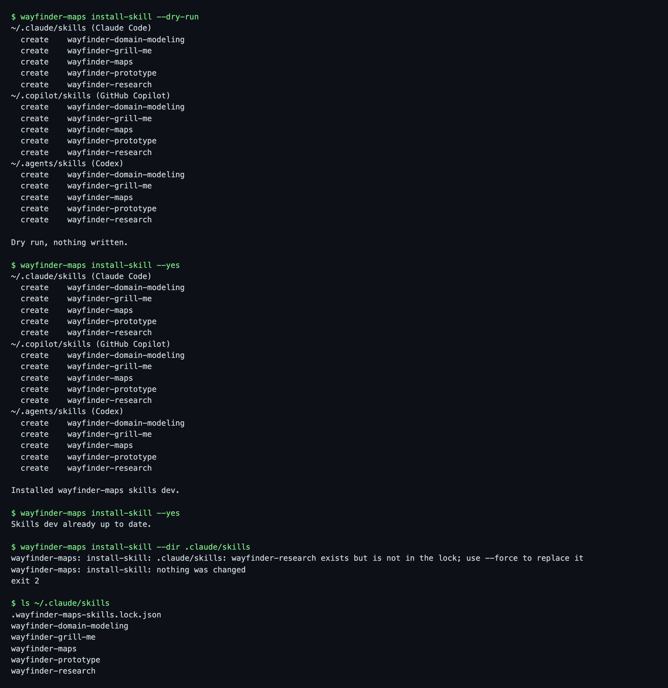
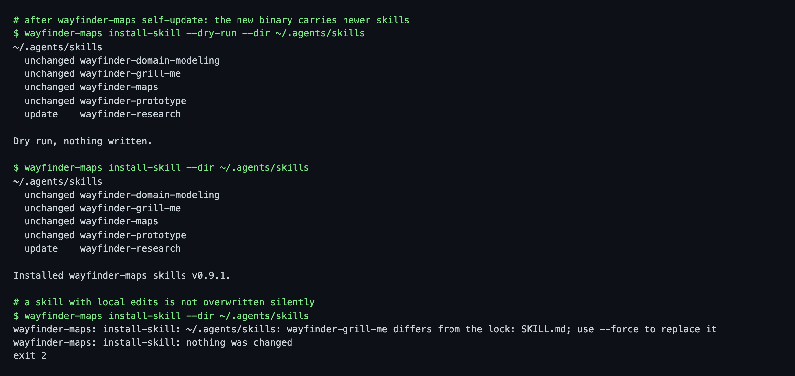
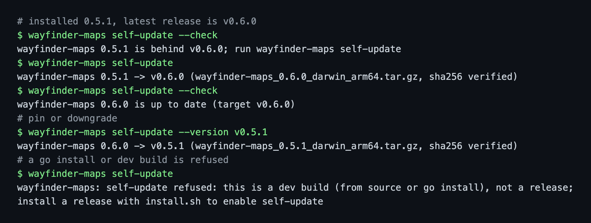

# Install

wayfinder-maps comes in two parts that install separately:

- the skills, which teach your agent the wayfinder method and write the map;
- the binary, which reads the map: `status`, `lint`, `pull` and the star-map viewer.

Skill and binary are independent, each just reads the on-disk contract.
The quickest route to both is the [install script](#install-script) plus [`install-skill`](#installing-the-skills).

## Skills, as a Claude Code plugin

```
/plugin marketplace add RamsesKools/wayfinder-maps
/plugin install wayfinder-maps@wayfinder-maps
```

`/wayfinder-maps` then works in every project, and the map lands in that project's `.plan/`.
The plugin bundles `wayfinder-maps` plus the four skills it invokes by name: `grill-me`, `research`, `prototype` and `domain-modeling`.
All five were originally authored by Matt Pocock in [mattpocock/skills](https://github.com/mattpocock/skills); the copies under [`skills/`](https://github.com/RamsesKools/wayfinder-maps/tree/main/skills) are MIT-licensed adaptations.

## Skills, drop-in for any harness

Copy [`skills/`](https://github.com/RamsesKools/wayfinder-maps/tree/main/skills) into your project and tell your agent to read `skills/wayfinder-maps/SKILL.md` and follow it; the skills it names live alongside.
You may include any of the extras under [`skills/.optional/`](https://github.com/RamsesKools/wayfinder-maps/tree/main/skills/.optional) too, [`skills/README.md`](https://github.com/RamsesKools/wayfinder-maps/blob/main/skills/README.md) describes the full set.
Or let the binary write them for you, see [Installing the skills](#installing-the-skills).

## The binary

### Install script

One-liner for macOS and Linux (amd64 and arm64):

```sh
curl -fsSL https://raw.githubusercontent.com/RamsesKools/wayfinder-maps/main/scripts/install.sh | bash
```

It resolves the release, verifies the archive against `checksums.txt`, extracts it to `~/.local/share/wayfinder-maps/` (honours `XDG_DATA_HOME`) and symlinks the binary into `~/.local/bin/`, so the double-clickable launchers stay next to the real binary.

```
~/.local/bin/
  wayfinder-maps          -> ~/.local/share/wayfinder-maps/wayfinder-maps
  wayfinder-maps-webview  -> ~/.local/share/wayfinder-maps/wayfinder-maps-webview  (Linux only)
~/.local/share/wayfinder-maps/
  wayfinder-maps
  wayfinder-maps-webview          (Linux only)
  wayfinder-app, wayfinder-web    (.command on macOS)
  .install.json                   receipt: version, commit, installed_at, asset, sha256
```

- Flags: `--version <tag>`, `--prefix <dir>`, `--bin-dir <dir>`, `--force`.
- Rerunning with the same version is a no-op.
- `<prefix>/.install.json` records what was installed (`version`, `commit`, `installed_at`, `asset`, `sha256`), which [`self-update`](#updating-the-binary) reads.

### Pinned release

```sh
curl -fsSL https://raw.githubusercontent.com/RamsesKools/wayfinder-maps/main/scripts/install.sh | bash -s -- --version v0.5.1
```

### By hand

Download an archive from [Releases](https://github.com/RamsesKools/wayfinder-maps/releases).
No Go toolchain is needed, and the native window and folder dialog work on all three platforms:

- macOS uses WKWebView, part of the OS.
- Windows uses WebView2, which ships with Windows 10 and 11.
- The Linux archive bundles a small helper that binds the system webkit, `libwebkit2gtk-4.1`.
  It is preinstalled on most desktops, otherwise run `sudo apt install libwebkit2gtk-4.1-0`.

`status` and `lint` need nothing installed at all, even headless.
The macOS and Linux archives also carry two double-clickable launchers, so no terminal is needed: `wayfinder-app` opens the native window and `wayfinder-web` starts the server and opens your browser (`.command` on macOS).

### With Go

```sh
go install github.com/RamsesKools/wayfinder-maps/cmd/wayfinder-maps@latest
```

### Check the version

`wayfinder-maps --version` prints the release version, and `dev` for a local build.
The Linux helper answers `wayfinder-maps-webview --version` the same way.

## Installing the skills

Install is two steps: the binary, then the skills that match it.

```sh
curl -fsSL https://raw.githubusercontent.com/RamsesKools/wayfinder-maps/main/scripts/install.sh | bash
wayfinder-maps install-skill
```

The skills are embedded in the binary, so they always match what `status` and `lint` do.
`install-skill` proposes the personal skills dir of each harness and asks per dir:

- `~/.claude/skills` (Claude Code)
- `~/.copilot/skills` (GitHub Copilot)
- `~/.agents/skills` (Codex)

Dirs that resolve to the same place (a symlinked `~/.claude/skills`, say) are installed once.
Copilot also reads the other two dirs, so declining its own dir avoids duplicates.

```sh
wayfinder-maps install-skill                        # ask per default dir
wayfinder-maps install-skill --yes                  # all default dirs, no questions (automation)
wayfinder-maps install-skill --dir .claude/skills   # project-local; repeatable, never asks
wayfinder-maps install-skill --only grill-me,research
wayfinder-maps install-skill --with-optional        # also the extras from skills/.optional/
wayfinder-maps install-skill --dry-run              # list what would change, write nothing
wayfinder-maps install-skill --force                # replace wayfinder dirs that are unmanaged or edited
```



- Without a terminal it needs `--yes` or `--dir`, so a script never writes into your agent dirs by accident.
- Skills install as `wayfinder-maps` and `wayfinder-<name>` (`wayfinder-grill-me`, `wayfinder-research`, ...), so they are recognisable in a dir listing and never clash with your own `grill-me`. Cross-references inside the skills are rewritten to match.
- Each dir gets `.wayfinder-maps-skills.lock.json` with `version`, `commit` (when the binary has an install receipt), `installed_at` and a sha256 per file. Only skill dirs listed in it are managed; everything else in the dir is left alone. Commit it when you vendor the skills into a repo (`--dir <repo>/skills` is the sync primitive).
- Without `--force` it stops with exit 2 and changes nothing (in any dir) when a target skill dir exists but is not in the lock, or has files that differ from the lock. A clean upgrade replaces the dirs and drops files removed upstream.
- Rerunning at the same version is a no-op.
- Each skill dir also carries the upstream MIT `LICENSE`.

## Updating the skills

A new release carries new embedded skills, so updating is the same two steps as installing:

```sh
wayfinder-maps self-update       # new binary, new embedded skills
wayfinder-maps install-skill     # skills dirs that follow the lock are upgraded in place
```



- Only skills whose content changed are shown as `update`; the rest stay `unchanged`, and a dir with no changes is not rewritten.
- An upgrade replaces the whole skill dir, so files removed upstream disappear, and the lock records the new `version`.
- A skill you edited locally (or a stray file in a managed skill dir) blocks the run with exit 2 and no changes in any dir. Re-run with `--force` to take upstream's version, or move your edits elsewhere first.
- Use `--dry-run` first to see which skills would change.

## Updating the binary

A binary installed from a release by `install.sh` upgrades itself in place:

```sh
wayfinder-maps self-update                    # latest release
wayfinder-maps self-update --version v0.5.1   # pin or downgrade
wayfinder-maps self-update --check            # report only, exit 1 if behind
wayfinder-maps self-update --force            # reinstall the same version
```



- It downloads the release archive and `checksums.txt`, verifies the sha256, then renames each file over the old one. A running `serve` or `app` keeps its old binary until restarted.
- It reads and rewrites `.install.json` next to the binary (same fields as `install.sh` writes), and refuses (exit 2, with the reason) for a `dev` build, a `go install` build, or any binary without that receipt.
- Windows is not supported yet.
- `WAYFINDER_RELEASES_URL` and `WAYFINDER_API_URL` point it at another release host, the same overrides `install.sh` honours.

## Outdated notice

When a newer release exists, commands end with a notice on stderr (terminal only, never in CI) naming the update command for how you installed the binary.
Setting `"updateCheck": false` in `settings.json` (or the Update check switch in the viewer) silences it, see [Outdated notice](features/update-notice.md).

## Build from source

```sh
go build ./cmd/wayfinder-maps      # pure Go: status, lint, serve
go test ./...
node --test cmd/wayfinder-maps/webtests/*.test.mjs   # viewer layout and markdown tests
```

Release builds inject the version with `-ldflags "-X github.com/RamsesKools/wayfinder-maps/internal/version.Version=<x.y.z>"`; without it `--version` prints `dev`, or the tag for a `go install ...@vX.Y.Z` build.

The native window needs cgo on macOS (WKWebView); Windows is pure Go (WebView2).
On Linux the webkit linkage lives in a separate helper, `./cmd/wayfinder-maps-webview`, built with `libwebkit2gtk-4.1-dev` and kept next to the main binary.
Releases are cut by the `release` workflow: CI builds the helper on Linux runners and GoReleaser packs everything.

To preview these docs, run `uv run mkdocs serve` from the repo root.
